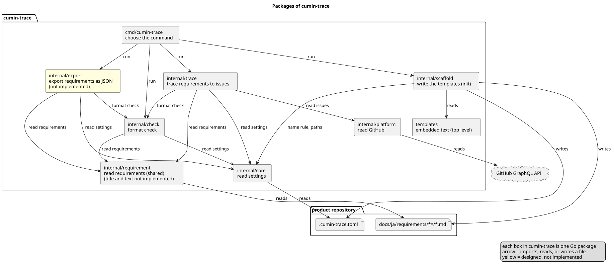

# ソースコード全体構成

cumin-trace のコードの地図である。機能ごとの設計文書は、この図のどこかにあたる。

図の元ファイル: [overview.puml](overview.puml)

設計だけがあり、まだコードがないパッケージは、役割の終わりに「(未実装)」と書く。

| パッケージ | 役割 | 設計 |
|---|---|---|
| `cmd/cumin-trace` | 引数からコマンドを選び、結果を終了コードにする | なし |
| `internal/check` | 書式検査 | [書式検査](../designs/check/index.md) |
| `internal/requirement` | 要件文書を読み、要件のモデルにする。書式検査、出力、対応づけが共有する | [書式検査](../designs/check/index.md) |
| `internal/core` | `.cumin-trace.toml` を読む | [書式検査](../designs/check/index.md)、[構造化データの出力](../designs/export/index.md)、[要件と要求Issueの対応づけ](../designs/trace/index.md) |
| `internal/export` | `cumin-trace export`。すべての要件を JSON に出す。要件の JSON の形を持つ | [構造化データの出力](../designs/export/index.md) |
| `internal/trace` | `cumin-trace trace`。要件と要求Issueを対応づけ、進捗と不整合を JSON に出す。Issueのモデルを持ち、`internal/platform` の型から変える | [要件と要求Issueの対応づけ](../designs/trace/index.md) |
| `internal/platform` | GitHub の GraphQL API を読み、自分で定義した Go の型で返す。GraphQL の型はここで止める (要求Issueの一覧、sub-issue、閉じた Pull Request を実装) | [要件と要求Issueの対応づけ](../designs/trace/index.md) |
| `internal/scaffold` | `cumin-trace init`。テンプレート、skill、スクリプト、workflow をリポジトリに書く | [テンプレートの生成](../designs/templates/index.md) |
| `templates` | リポジトリに書く文を埋め込む。リポジトリの最上位のディレクトリ | [テンプレートの生成](../designs/templates/index.md) |
