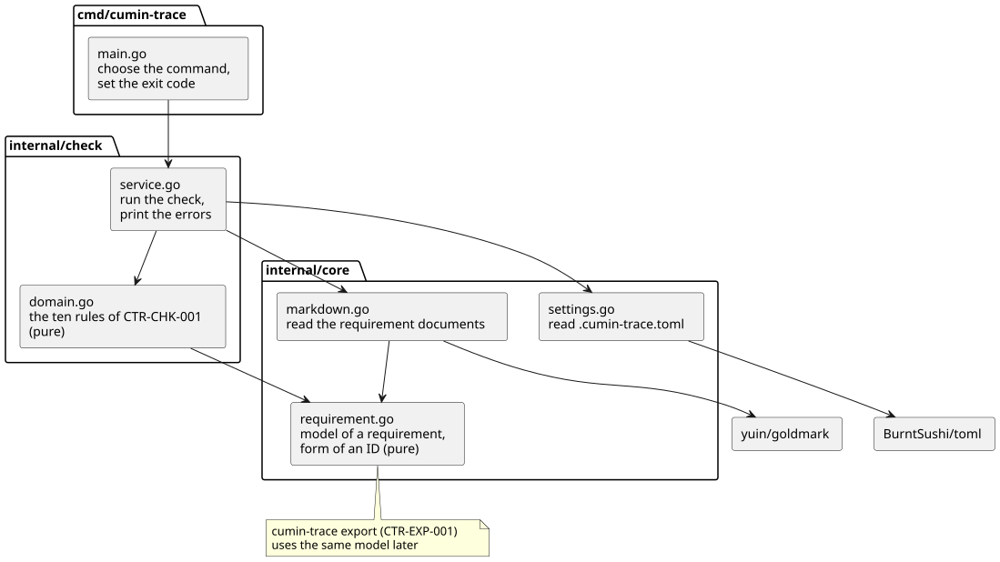

# 書式検査の設計

`cumin-trace check` (書式検査) の設計を記述する。要件は [書式検査](../requirements/check/index.md) (`CTR-CHK-001` 〜 `CTR-CHK-004`) と [要件文書の書式](../requirements/format/index.md) (`CTR-FMT-001` 〜 `CTR-FMT-012`) にある。この文書は、要件が決めていない「どう作るか」だけを決める。

書式検査が読み取った要件は、あとで `cumin-trace export` (`CTR-EXP-001`) がそのまま使う。対応づけも同じものを使う。要件のモデルと要件文書の読み取りはプロダクトの中心なので、それ自身の機能のパッケージ `internal/requirement/` に置く。`internal/core/` には、プロダクトを知らない共通の土台である、設定の読み取りだけを置く。

## 実装の状況

この文書は、書式検査の全体の設計である。コードは、その一部を実装している。

| 設計 | コード |
|---|---|
| 設定ファイル | すべて実装している |
| 読むファイル、要件の見出し、IDの形式 | 実装している。要件の範囲は、上の見出しを決めるためだけに使う。タイトルと本文は、まだ読まない |
| フィールド | すべて実装している |
| 参照 | まだ読まない |
| 要件のモデル | `Title` と `Body` 以外を持つ。読み取りの結果は、要件の一覧と、IDの形式が正しくない要件の見出しの一覧の2つである |
| エラー | 7 (存在しないIDを参照している) と 8 (廃止した要件を、置き換え先の指定以外で参照している) 以外を検出する |
| 出力と終了コード | すべて実装している |

## パッケージとファイル



図の元ファイル: [check-packages.puml](check-packages.puml)

| ファイル | 役割 |
|---|---|
| `cmd/cumin-trace/main.go` | 引数からコマンドを選び、結果を終了コードにする |
| `internal/check/service.go` | 設定と要件文書を読み、ルールを適用し、エラーを出力する |
| `internal/check/domain.go` | `CTR-CHK-001` の10個のルールと、エラーの並べ方。純粋な関数で、I/O を持たない |
| `internal/requirement/domain.go` | 要件のモデルと、IDの形式。純粋な関数で、I/O を持たない |
| `internal/requirement/markdown.go` | 要件文書のファイルを集め、Markdown を読んで、要件のモデルにする |
| `internal/core/settings.go` | `.cumin-trace.toml` を読み、値を確かめる |

- ライブラリの型は、それを使う1ファイルの外に出さない。`toml` の型は `internal/core/settings.go` で、`goldmark` の型は `internal/requirement/markdown.go` で止める。
- `internal/check/` は、`internal/requirement/` と `internal/core/` を使う。`internal/requirement/` は `internal/core/` を import しない。読み取りは、リポジトリの最上位、要件文書のディレクトリ、接頭辞を引数で受け取り、`service.go` が設定から渡す。
- interface は作らない。テストは、一時ディレクトリに書いた文書と設定を、本物の読み取りで読む。
- `internal/check/` は `net/http` を import せず、環境変数も読まない (`CTR-CHK-004`)。
- `check.Run(root string, stdout io.Writer) (int, error)` が入口である。`root` はリポジトリの最上位のディレクトリ、戻り値はエラーの件数である。`main.go` は `root` に `.` を渡す。

## 設定ファイル

### キー

`.cumin-trace.toml` は、リポジトリの最上位に置く。書式検査が読むキーは次の3つである (`CTR-FMT-011`、`CTR-FMT-001`)。

```toml
# プロダクトの接頭辞
prefix = "CTR"

# 使ってよいカテゴリ。書いた順が、出力の順になる (CTR-EXP-002)
areas = ["FMT", "TPL", "CHK", "EXP", "TRC", "SITE", "DASH"]

# 要件文書のディレクトリ。省略できる
requirements_dir = "docs/ja/requirements"
```

| キー | 型 | 必須 | 決まり |
|---|---|---|---|
| `prefix` | 文字列 | 必須 | 英大文字と数字が1文字以上 |
| `areas` | 文字列の配列 | 必須 | 1つ以上。それぞれ英大文字と数字が1文字以上。同じ名前を2回書かない |
| `requirements_dir` | 文字列 | 省略できる | リポジトリの最上位からの相対パス。区切りは `/`。絶対パスと `..` は書けない。既定は `docs/ja/requirements` |

- 知らないキーがあれば、設定のエラーにする。キーの書き間違いに気付けるようにするためである。ほかの機能 (対応づけ、サイト) がキーを足すときは、同じ構造体に足す。
- カテゴリの名前とディレクトリの名前が合っているかは、確かめない。`CTR-CHK-001` の表にないためである。

### TOML の読み方

`github.com/BurntSushi/toml` の v1.6.0 を使う。

| 理由 | 根拠 |
|---|---|
| Go の標準ライブラリに TOML のパーサがない | Go 1.27.2 で `go list std` を確かめた |
| TOML のパーサを自分で書くことは、[ライブラリの方針](../requirements/technology.md) が禁じる「部品の作り直し」にあたる | 自分の判断 |
| cumin-works が同じライブラリの同じバージョンを使っている。知識とやり方を使い回せる | cumin-works の `go.mod` |
| 標準ライブラリ以外に依存しない。MIT ライセンスである | 公式ページと、`go list -deps` |
| 知らないキー (`MetaData.Undecoded`) と、構文エラーの行番号 (`ParseError.Position.Line`) を取れる | 公式ページと、手元の実行 |

確かめた公式ページ: <https://pkg.go.dev/github.com/BurntSushi/toml> (v1.6.0、2025-12-18 公開)。`Decode`、`MetaData.Undecoded`、`MetaData.IsDefined`、`ParseError` の定義を読んだ。対応する TOML のバージョンは、このページの README では v1.1.0、概要では v1.0.0 と書いてある。上の3つのキーは、どちらのバージョンでも同じ書き方である。

もう1つの候補 `github.com/pelletier/go-toml/v2` は、公式ページを確かめていない。cumin-works と同じライブラリで足りるので、比べなかった。

## Markdown の読み方

### ライブラリ

`github.com/yuin/goldmark` の v1.8.6 を、拡張なし (CommonMark だけ) で使う。HTML には変換せず、構文木だけを使う。

| 理由 | 根拠 |
|---|---|
| Go の標準ライブラリに Markdown のパーサがない | Go 1.27.2 で `go list std` を確かめた |
| 行を1行ずつ読む自前の読み方では、コードブロックの範囲を正しく決めにくい。箇条書きの中のフェンス、字下げのコードブロック、`~~~` のフェンス、本文の直後の `---` (見出しになる) がある。読み違えると、コードブロックの中の例を要件として読む | 自分の判断。CommonMark の仕様に沿うパーサは大きな部品である |
| CommonMark 0.31.2 に準拠する。GitHub での見え方と、書式検査の読み方が合う | 公式ページ |
| 標準ライブラリ以外に依存しない。MIT ライセンスである | 公式ページと、`go list -deps` |
| 構文木のノードが、元の文書での位置を持つ。行番号を出せる | 公式ページと、手元の実行 |

確かめた公式ページ: <https://pkg.go.dev/github.com/yuin/goldmark> (v1.8.6、2026-09-03 公開) と <https://pkg.go.dev/github.com/yuin/goldmark/ast>。`Parser().Parse(text.NewReader(source))`、`ast.Walk`、`Heading.Level`、`FencedCodeBlock`、`CodeBlock`、`HTMLBlock`、`CodeSpan`、`ListItem`、`List.IsOrdered`、`Text.Segment`、`Lines()` を読んだ。

手元の実行で確かめたこと (v1.8.6):

- 見出しの最初の子が `CodeSpan` かどうかで、IDで始まる見出しを見分けられる。`#` の見出しと、下線 (`---`) の見出しのどちらも `Heading` になる。
- 見出しの行番号は `Lines().At(0).Start`、文字の行番号は `Text.Segment.Start` から、それより前の改行を数えて求められる。
- 拡張なしでは、表の行は段落の文字として読まれる。表の中のIDも `Text` として読める。
- 本文のIDは、1つの `Text` の中に切れずに入る。

goldmark には v2 がある (v2.1.6、2026-09-27 公開)。v1.8.6 を選ぶ理由は次のとおりである。

| 理由 | 根拠 |
|---|---|
| v2 の README が「v2 is still in the early stages of release」と書いている | v2 の公式ページ |
| v1 は、バグとセキュリティの修正を受け続ける。修正の対象は、最新のメジャーバージョンと、その1つ前までである | v2 の公式ページ |
| v2 では、この設計が使う API が変わっている。`Parse` の引数、`Text.Segment`、`Lines()`、`CodeSpan` の子がない。上の「手元の実行で確かめたこと」は v1 だけで確かめた | v2 の公式ページ |

確かめた公式ページ: <https://pkg.go.dev/github.com/yuin/goldmark/v2>。v2 に移るのは、v1 が修正の対象から外れるときである。ライブラリの型は `internal/requirement/markdown.go` の外に出ないので、変えるのはこの1ファイルで済む。

### 読むファイル

- `requirements_dir` の下の、名前が `.md` で終わるファイルを、深さを問わずすべて読む (`CTR-FMT-001`)。シンボリックリンクはたどらない。
- ファイルは、リポジトリの最上位からの相対パス (区切りは `/`) の、バイト順に並べて読む。
- 文字コードは UTF-8 とする。行番号は、ファイルの先頭を1として、改行 (`\n`) を数える。
- ファイルの1行目が `---` だけのときは、次の `---` か `...` だけの行までを frontmatter とみなす。この範囲は、改行以外を空白に置き換えてからパーサに渡す。行番号は変わらず、frontmatter の中は読まれない。閉じる行がないファイルには frontmatter がないものとして、そのまま読む。

### 見出しと、要件の範囲

- 見出しの「上の見出し」とは、同じファイルでそれより前にある、レベルがより上 (数字が小さい) の見出しのうち、最も近いものである。
- 要件の見出しは、最初の要素がコードスパンで、その中身が `<接頭辞>-` で始まる見出しである (`CTR-FMT-003`)。レベルは問わない。
- それ以外の見出しは、要件の見出しではない。IDを持たない見出し、ほかのプロダクトのIDで始まる見出し、IDをバッククォートで囲んでいない見出しが、これにあたる。
- 要件の見出しのコードスパンの中身が、IDである。タイトルは、見出しの行のうちコードスパンより後ろを、前後の空白を除いて、書いたままの文字で持つ。
- 要件の範囲は、その見出しの次の行から、同じレベルか上のレベルの次の見出しの前までである。区切り線は範囲に影響しない (`CTR-FMT-003`)。
- 文書のある行が属する要件は、その行の上の見出しを順にたどって、最初に見つかる要件の見出しである。

### IDの形式

正しいIDは、次の正規表現に全体が一致する文字である (`CTR-FMT-002`、`CTR-FMT-004`)。`P` は設定の接頭辞である。

```text
P-[A-Z0-9]+-[0-9]{3}(\.[1-9][0-9]*)?
```

- 子の番号は1段だけである。`CTR-FMT-003.1.2` は正しくない。
- 親のIDは、IDから `.<子の番号>` を除いたものである。見出しの入れ子からは決めない。
- 子を持つ要件とは、そのIDを親のIDとする要件が、文書のどこかにある要件である。

### 参照

参照は、次のすべてを満たす文字である (`CTR-FMT-010`)。

1. 上の正規表現に一致する。最も長く一致する範囲を取る。
2. 直前の文字が、英数字でも `-` でもない。
3. 直後の文字が、英数字ではない。
4. 直後が、`.` と数字の並びではない。文の終わりの `.` は、直後にあってよい。

そのため、`CTR-TRC`、`CTR-FMT-01`、`CTR-FMT-003.1.2` のように形式に合わない文字は、参照ではなく、エラーにもならない。IDの形式のエラーになるのは、要件の見出しだけである。

| 場所 | 参照を読むか |
|---|---|
| 段落、表、箇条書き、引用、強調、リンクの文字、コードスパン、要件ではない見出し | 読む |
| `検証` の行 | 読む |
| `状態` の行 | 読まない。置き換え先として別に扱う |
| 要件の見出し (IDの形式が正しくないものを含む。タイトルも含む) | 読まない |
| コードブロック (フェンスと字下げ)、HTML のブロック、文中の HTML、リンクの宛先、frontmatter | 読まない |

実装では、構文木の `Text` ノードだけを調べ、`FencedCodeBlock`、`CodeBlock`、`HTMLBlock` と要件の見出しの下には入らない。

### フィールド

- フィールドは、文書の最上位にある箇条書き (番号なし) の項目で、最初の行が `検証:` か `状態:` で始まるものである (`CTR-FMT-005`)。コロンは半角である。
- 入れ子の箇条書き、引用の中の箇条書き、番号付きの箇条書き、ほかの名前の項目は、本文として扱う。
- フィールドの値は、最初の行のコロンより後ろを、前後の空白を除いたものである。
- フィールドは、その行が属する要件のものである。属する要件がないとき、または、たどり着いた見出しのIDの形式が正しくないときは、読まない。
- `検証` の値がコードスパンで始まるとき、その中身が方法、残りが確かめ方である (`CTR-FMT-006`)。コードスパンで始まらないときは、方法は空で、値の全体が確かめ方である。
- `状態` の値は、次のどちらかに全体が一致するときだけ正しい (`CTR-FMT-008`)。`<ID>` は正しい形式のIDで、バッククォートで囲んでも囲まなくてもよい。`。` の後ろと `<ID>` の後ろの空白は、あってもなくてもよい。
  - `廃止`
  - `廃止。<ID> に置き換え`
- `状態` が複数行あるときは、1行ずつ確かめる。正しい行が1つでもあれば、その要件は廃止である。置き換え先は、正しい行のうち最初のものから取る。

## 要件のモデル

`internal/requirement/domain.go` に置く。`CTR-EXP-001` が挙げる値を、すべて持つ。

| 値 (`CTR-EXP-001`) | フィールド | 型 | 中身 |
|---|---|---|---|
| ID | `ID` | `string` | 見出しのコードスパンの中身 |
| 親のID | `ParentID` | `string` | 子要件でなければ空 |
| タイトル | `Title` | `string` | 見出しのコードスパンより後ろ |
| 本文 | `Body` | `string` | 下の決まりで取り出した Markdown |
| 検証の一覧 | `Verifications` | `[]Verification` | 文書に書いた順 |
| 方法 | `Verification.Method` | `string` | コードスパンで始まらなければ空 |
| 確かめ方 | `Verification.Description` | `string` | |
| 状態 | `Deprecated` | `bool` | 廃止なら `true`。状態は廃止だけである (`CTR-FMT-008`) |
| 置き換え先 | `ReplacedBy` | `string` | なければ空 |
| ファイル | `File` | `string` | リポジトリの最上位からの相対パス。区切りは `/` |
| 行番号 | `Line` | `int` | 見出しの行 |

本文は、要件の範囲の行から、次の行を除いたものである。残った行を書いたままつなぎ、先頭と末尾の空行を除く。

- その範囲の中にある、ほかの要件の見出しと、その範囲の行
- フィールドの項目の行 (項目が複数行にわたるときは、そのすべて)
- 区切り線の行

書式検査だけが使う値も、同じモデルに持つ。出力には使わない。

| フィールド | 中身 |
|---|---|
| `Requirement.Level` | 見出しのレベル |
| `Requirement.Above` | 上の見出しが正しいIDの要件の見出しなら、そのIDとレベル。そうでなければ空 |
| `Verification.Line` | `検証` の行番号 |
| `Requirement.Statuses` | `状態` の行ごとの、値と行番号 |

読み取りの結果は、次の3つである。どれも、ファイルの順、その中では行の順に並ぶ。カテゴリの順に並べ替えるのは、出力の仕事である (`CTR-EXP-002`)。

- 要件の一覧。正しい形式のIDを持つ要件の見出しを、すべて含む。同じIDが2つあれば、2つとも含む
- IDの形式が正しくない要件の見出しの一覧 (コードスパンの中身、ファイル、行番号)
- 参照の一覧 (ID、ファイル、行番号)

## エラー

書式検査は、`CTR-CHK-001` の表にある10個だけを検出する。表にない書き方 (タイトルが空、IDの後ろの空白が2つ、など) は、エラーにしない。

メッセージは英語の決まった文とする。出力を Pull Request や Issue にそのまま貼れるようにするためである。

| # | エラー (`CTR-CHK-001`) | 条件 | 行 | ID | メッセージ |
|---|---|---|---|---|---|
| 1 | IDの形式が正しくない | 要件の見出しのコードスパンの中身が、正しいIDではない | 見出し | コードスパンの中身 | `invalid ID format: want <prefix>-<area>-<3 digits>, or that with .<child number>` |
| 2 | 同じIDが2か所以上にある | 同じIDの要件の見出しが、2つ以上ある。そのすべてについて1行ずつ報告する | 見出し | そのID | `duplicate ID: also at <file>:<line>` (ほかの場所が複数あれば `, ` で並べる) |
| 3 | 子要件が、親の見出しの外にある | 子要件の上の見出しが、親のIDの要件の見出しではない。または、レベルが親よりちょうど1つ深くない | 見出し | 子要件のID | `child requirement is not under its parent: put it one level below the heading of <parent ID>` |
| 4 | 検証の書き始めが、4つの方法のどれでもない | `検証` の方法が、`test`、`demo`、`inspection`、`analysis` のどれでもない | `検証` の行 | 要件のID | ``verification must start with `test`, `demo`, `inspection`, or `analysis` in a code span`` |
| 5 | 子を持たない要件に、検証がない | 子を持たない要件に、`検証` の行が1つもない。方法が正しくない行も、1行と数える。廃止した要件も対象である | 見出し | 要件のID | `no verification: a requirement without children needs a 検証 line` |
| 6 | 状態に、廃止以外が書いてある | `状態` の値が、正しい2つの形のどちらでもない | `状態` の行 | 要件のID | `invalid status: want 廃止, or 廃止。<ID> に置き換え` |
| 7 | 存在しないIDを参照している | 参照、または置き換え先のIDを持つ要件が、文書にない | 参照の行 | 参照したID | `reference to an ID that does not exist` |
| 8 | 廃止した要件を、置き換え先の指定以外で参照している | 参照のIDを持つ要件が、廃止である。置き換え先は、廃止した要件を指してもよい | 参照の行 | 参照したID | `reference to a deprecated requirement` |
| 9 | 設定にないカテゴリのIDがある | 要件のIDのカテゴリが、`areas` にない。参照には適用しない (7 になる) | 見出し | 要件のID | `area <area> is not in .cumin-trace.toml` |
| 10 | 連番、または子の番号が空いている | 下の決まり | 見出し | 空きの次の要件のID | `number gap: <ID> is missing`、`number gap: <ID> to <ID> are missing`、`number gap: numbers start at 001` |

10 の決まり (`CTR-FMT-012`):

- カテゴリごとに、子要件ではない要件の連番を集める。`areas` にないカテゴリも、同じように調べる。
- 親のIDごとに、子の番号を集める。
- 集めた番号は、1 から最大の番号まで、すべてそろっていなければならない。
- 空きごとに1件を報告する。報告する場所は、空きのすぐ上の番号を持つ要件である。同じ番号の要件が複数あるときは、読み取りの順で最初のものである。メッセージには、空いているID (1つ、または最初と最後) を書く。
- 連番が `000` の要件は、`number gap: numbers start at 001` で報告する。
- 要件を並べた順は調べない。

## 出力と終了コード

エラーは、1件を1行で、標準出力に書く (`CTR-CHK-002`)。

```text
<file>:<line>: <ID>: <message>
```

```text
docs/ja/requirements/check/index.md:15: CTR-CHK-001: duplicate ID: also at docs/ja/requirements/format/index.md:82
docs/ja/requirements/format/index.md:120: CTR-FMT-099: reference to an ID that does not exist
```

- `<file>` は、リポジトリの最上位からの相対パスで、区切りは `/` である。
- エラーは、ファイル、行番号、上の表の #、ID、メッセージの順に並べる。ID とメッセージは、バイト順で比べる。
- 同じ行にある同じIDへの参照は、何回書いてあっても1つの参照として数える。参照の一覧は、ファイル、行番号、IDの組ごとに1件である。
- この2つにより、5つのキーがすべて同じエラーは2件にならず、並び順は1通りに決まる。同じ入力からは、常に同じ出力になる。
- 標準出力には、エラーの行だけを書く。エラーがなければ、何も書かない。
- エラーがあるときは、最後に、標準エラー出力へ `cumin-trace: <n> errors` を書く (1件のときは `1 error`)。
- 書式検査を実行できないときは、標準エラー出力へ `cumin-trace: <message>` を書く。構文エラーのように場所が分かるときは、`cumin-trace: .cumin-trace.toml:<line>: <message>` と書く。

| 終了コード | 意味 (`CTR-CHK-003`) |
|---|---|
| 0 | エラーがない |
| 1 | 書式のエラーが1件以上ある |
| 2 | 書式検査を実行できない。設定ファイルがない、設定が正しくない、要件文書のディレクトリがない、ファイルを読めない、コマンドの使い方が正しくない |

- `cumin-trace check` は、リポジトリの最上位のディレクトリで実行する。引数とフラグは取らない。余分な引数があれば、終了コード 2 にする。
- 要件文書のディレクトリはあるが、要件が1つもないときは、終了コード 0 にする。
- 書式検査はログを出さない。
