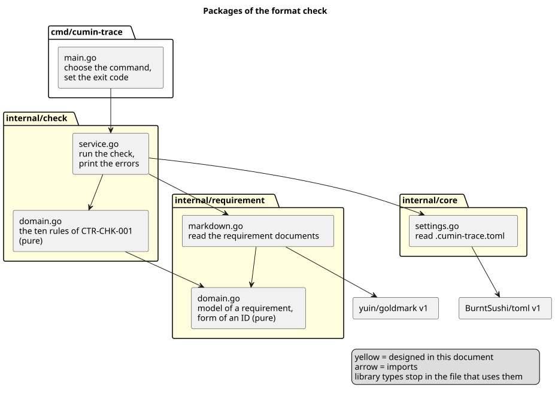
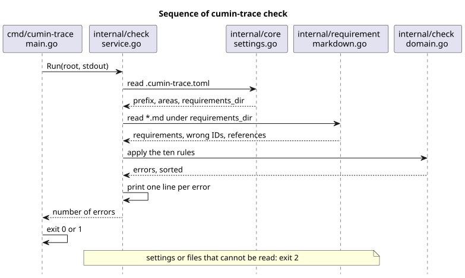

# 書式検査の設計

`cumin-trace check` が、設定と要件文書をどう読み、エラーをどう決めて出すかを決める。

## 要件

- [書式検査](../../requirements/check/index.md)
  - `CTR-CHK-001` 検出するエラー
  - `CTR-CHK-002` エラーの報告
  - `CTR-CHK-003` 終了コード
  - `CTR-CHK-004` 入力は要件文書だけ
- [要件文書の書式](../../requirements/format/index.md)
  - `CTR-FMT-001` 要件文書の場所と形式
  - `CTR-FMT-003` 要件は見出しで書く
  - `CTR-FMT-010` 要件への参照
  - `CTR-FMT-002` IDの形式
  - `CTR-FMT-011` プロダクトとカテゴリの設定
  - `CTR-FMT-004` 子要件
  - `CTR-FMT-012` 番号を空けない
  - `CTR-FMT-005` フィールド
  - `CTR-FMT-006` 検証の方法
  - `CTR-FMT-007` 検証が必要な要件
  - `CTR-FMT-008` 廃止

## 全体像

[ソースコード全体構成](../../architecture/overview.md) の `internal/check`、`internal/requirement`、`internal/core` にあたる。

図の元ファイル: [check-packages.puml](check-packages.puml)

図の元ファイル: [check-sequence.puml](check-sequence.puml)

## 決めたこと

### 要件の読み取りは、独立したパッケージに置く

要件のモデルと要件文書の読み取りを `internal/requirement` に置き、`internal/check` から使う。`internal/core` には、設定の読み取りだけを置く。

- 理由: 出力 (`CTR-EXP-001`) と対応づけが、同じ読み取りを使う。要件の読み取りはプロダクトの中心なので、`internal/core` (プロダクトを知らない土台) には置かない。
- 細部: [パッケージとファイル](packages.md)

### 設定は `.cumin-trace.toml` の3つのキー

`prefix`、`areas`、`requirements_dir` を読む。知らないキーは、設定のエラーにする。

- 理由: キーの書き間違いに、すぐ気付ける。
- 細部: [設定ファイル](settings.md)

### TOML は `BurntSushi/toml` v1 で読む

- 理由: 標準ライブラリにない。cumin-works と同じライブラリで、知らないキーと構文エラーの行番号を取れる。
- 採らなかった案: 自分で書く。[ライブラリの方針](../../requirements/technology.md) が禁じる部品の作り直しにあたる。
- 細部: [設定ファイル](settings.md)

### Markdown は `goldmark` v1 の構文木で読む

拡張なし (CommonMark だけ) で構文木を作り、HTML には変換しない。

- 理由: コードブロックの中の例を、要件として読まないため。CommonMark に準拠するので、GitHub での見え方と読み方が合う。
- 採らなかった案: 行ごとの自前の読み方。箇条書きの中のフェンス、字下げのコードブロック、`~~~` のフェンス、本文の直後の `---` (見出しになる) を読み違える。
- 採らなかった案: goldmark v2。README が「v2 is still in the early stages of release」と書き、この設計が使う API が変わっている。v1 が修正の対象から外れたら移る。変えるのは `markdown.go` の1ファイルである。
- 細部: [要件文書の読み方](reading.md)

### エラーは決まった英語の文で、1件1行

`<file>:<line>: <ID>: <message>` を標準出力に書く。順序は、ファイル、行、エラーの番号、ID、メッセージで、1通りに決める。

- 理由: Pull Request や Issue にそのまま貼れる。同じ入力からは、常に同じ出力になる。
- 細部: [エラーと出力](errors.md)
