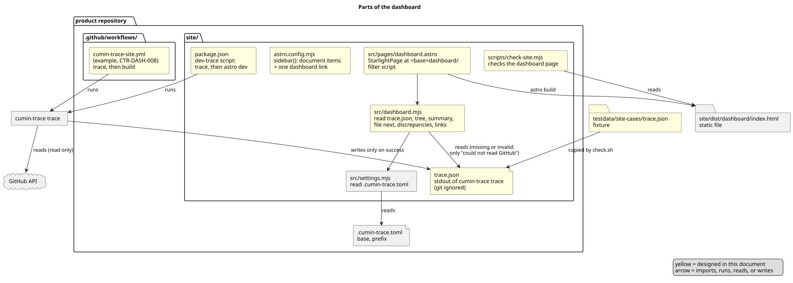

# ダッシュボードの設計

要件の木、集計、次に起票する要件、不整合を1ページに表示するダッシュボードの仕組みを決める。入力は、`cumin-trace trace` の標準出力を書いた `site/trace.json` である。ページは Starlight のサイトの1ページとして、ビルドのときに作る。

## 要件

- [ダッシュボード](../../requirements/dashboard/index.md)

| 要件 | 実装するファイル | 決まり |
|---|---|---|
| `CTR-DASH-001` 要件の木 | `site/src/dashboard.mjs` の `tree()`、`site/src/pages/dashboard.astro` | [ページ](page.md) の「要件の木」 |
| `CTR-DASH-002` マイルストーンごとの集計 | `site/src/dashboard.mjs` の `summary()` | [ページ](page.md) の「集計」 |
| `CTR-DASH-003` 次に起票する要件 | `site/src/dashboard.mjs` の `fileNext()` | [ページ](page.md) の「次に起票する要件」 |
| `CTR-DASH-004` 絞り込み | `site/src/pages/dashboard.astro` のインラインのスクリプト | [ページ](page.md) の「絞り込み」 |
| `CTR-DASH-005` リンク | `site/src/dashboard.mjs` の `requirementURL()` と `issueURL()` | [ページ](page.md) の「リンク」 |
| `CTR-DASH-006` 読んだ時刻の表示 | `site/src/dashboard.mjs` の `readTrace()` | [ページ](page.md) の「入力」 |
| `CTR-DASH-007` 静的なページ | `site/src/pages/dashboard.astro` (`astro build` の出力の HTML) | [ページ](page.md) の「確かめ方」 |
| `CTR-DASH-008` 自動での更新 | `templates/workflows/cumin-trace-site.yml` (`init` が `.github/workflows/cumin-trace-site.yml` に書く) | [ページ](page.md) の「workflow の例」 |
| `CTR-DASH-009` 不整合の表示 | `site/src/dashboard.mjs` の `discrepancies()` | [ページ](page.md) の「不整合」 |

関わる要件: `CTR-SITE-009` (文書のページは文書だけから作る)、`CTR-SITE-005` (手元でのプレビュー)、`CTR-TRC-008` (対応づけの結果の JSON)。

## 全体像

[ソースコード全体構成](../../architecture/overview.md) の `templates/site` と、プロダクトのリポジトリの `site` にあたる。黄色が、この文書で決めるものである。

図の元ファイル: [dashboard-packages.puml](dashboard-packages.puml)

## 公式文書の確認

バージョンは [サイトの設計](../site/index.md) の Astro 7.4.0 と Starlight 0.42.6 のままである。2026-10-20 に、次のページを読んだ。

| 事実 | 確かめたページ |
|---|---|
| `src/pages/` の `.astro` のファイルは、そのパスと名前の URL のページになる。このページは静的で、ビルドのときに作られる | Astro [Routing](https://docs.astro.build/en/guides/routing/) |
| Starlight の外のページは、`src/pages/` に置き、`@astrojs/starlight/components/StarlightPage.astro` で包むと、Starlight の見た目になる。`frontmatter` が必須で、その中で必須なのは `title` だけである。`sidebar` を渡さなければ、サイト全体のサイドバーを使う | Starlight [Pages](https://starlight.astro.build/guides/pages/) |
| `sidebar` に `{ label, link }` を置くと、docs のコレクションの外のページへのリンクになる | Starlight [Sidebar Navigation](https://starlight.astro.build/guides/sidebar/) |

上の表にない振る舞いは、「推測」と記す。実装の Issue で、`npm run check-site` で確かめる。

## 決めたこと

### 入力は `site/trace.json` で、git に入れない

ダッシュボードは、`site/trace.json` を読む。中身は `cumin-trace trace` の標準出力 ([対応づけのコマンド](../trace/command.md) の「JSON」) である。`site/.gitignore` と `templates/site/gitignore` に `trace.json` を足す。

- 理由: `trace` は JSON を標準出力に書くだけで、ファイルの置き場を持たない。`site/` に置けば、サイトのビルドだけが読む。GitHub の状態は時刻で変わるので、コミットしない。
- 採らなかった案: ビルドの中で `cumin-trace trace` を動かす。ビルドが token とネットワークを要し、`CTR-SITE-009` と `CTR-SITE-005` に合わない。
- 採らなかった案: 構造化データの出力 (`export`) も読む。`trace` の要件は `export` と同じキーを持つので、要らない。
- 細部: [ページ](page.md) の「入力」

### 読めない `trace.json` は「GitHub を読めなかった」だけを表示する

`trace.json` がない、JSON として読めない、形が `trace` の JSON に合わない、のどれでも、ページは GitHub を読めなかったことだけを表示する (`CTR-DASH-006`)。ビルドは失敗しない。

- 理由: `trace` は失敗すると何も書かない。手元で token なしにプレビューしても、文書のページは表示される (`CTR-SITE-005`)。
- 採らなかった案: ビルドを失敗にする。文書のページも作られなくなる。

### ページは `src/pages/dashboard.astro` の `StarlightPage` で、サイドバーの最後に1つのリンクを足す

`site/src/pages/dashboard.astro` が `StarlightPage` でページを作る。URL は `<base>dashboard/` である。`astro.config.mjs` は、`sidebar()` の項目の後ろに `{ label: "ダッシュボード", link: "<base>dashboard/" }` を1つ足す。

- 理由: docs のコレクションは文書だけを読む (`CTR-SITE-009`)。コレクションの外のページなら、文書のページの作り方を変えない。
- 推測: Starlight が `link` に `base` を足すかは、公式文書に書いていない。`check-site` が、サイドバーのリンクの `href` が `<base>dashboard/` であることを確かめる。
- 採らなかった案: `docs_dir` にダッシュボードの文書を置かせる。文書が GitHub の状態を持つことになる。
- 細部: [ページ](page.md)

### 木、集計、一覧、リンクは、ビルドのときに `dashboard.mjs` で決める

表示のための値は、すべて `site/src/dashboard.mjs` の純粋な関数で、ビルドのときに作る。ブラウザで動くのは、絞り込みのインラインのスクリプトだけである (`CTR-DASH-007`)。

- 理由: 値を関数にすると、`check-site` が同じ関数で期待する値を作れる。
- 採らなかった案: ブラウザで `trace.json` を読んで描く。表示に JavaScript が要り、`check-site` が HTML で確かめられない。
- 細部: [ページ](page.md)

### 集計は、子を持たない要件を、要求Issueのマイルストーンごとに1回数える

集計の行は、子を持たない要件を、その要求Issue (not planned で閉じたものを除く) の異なるマイルストーンごとに1回数える。2つのマイルストーンの要求Issueを持つ要件は、2つの行に出る。

- 理由: マイルストーンは要求Issueに付く。1つの行にだけ数えると、どの行に入れるかの決まりが要る。
- 細部: [ページ](page.md) の「集計」

### テストは `check-site` の行と、`testdata/site-cases/` の trace の fixture

`check-site` が、ダッシュボードのページを HTML で確かめる。`testdata/site-cases/trace.json` を `check.sh` が `site/trace.json` に写し、決まった値で確かめる。

- 理由: `check-site` はネットワークも token も使わない。fixture なら、どの手元でも同じ結果になる。
- 細部: [ページ](page.md) の「確かめ方」

### 手元では、1つのスクリプトが trace とプレビューを動かす

`site/package.json` と `templates/site/package.json` に、スクリプト `dev-trace` を足す。`trace` を動かし、成功したときだけ `trace.json` を置き、そのあと `astro dev` を始める。`trace` が失敗しても、`trace.json` は残らず、`astro dev` は始まる。

- 理由: `dashboard-update.puml` の注記 (手元では1つのコマンドで同じことをし、プレビューを始める) を満たす。`npm run dev` は、今のとおり GitHub を読まない。
- 採らなかった案: `npm run dev` に `trace` を足す。token のない手元で、毎回失敗のメッセージが出る。
- workflow は、このスクリプトを使わず、trace とビルドを別の step で動かす。
- 細部: [ページ](page.md) の「コマンド」

### workflow の例は、trace が失敗すると何もビルドしない

`init` が書く `.github/workflows/cumin-trace-site.yml` は、main への push と定期実行で、trace、`npm ci`、`npm run build` を順に動かす (`CTR-DASH-008`)。trace が失敗すると、job は失敗し、ビルドしない。サイトをどこに置くかは書かない。

- 理由: 失敗したビルドからは何も公開されないので、プロダクトが公開しているサイトは前のまま残る。GitHub を読めない表示を公開しない。
- 細部: [ページ](page.md) の「workflow の例」
