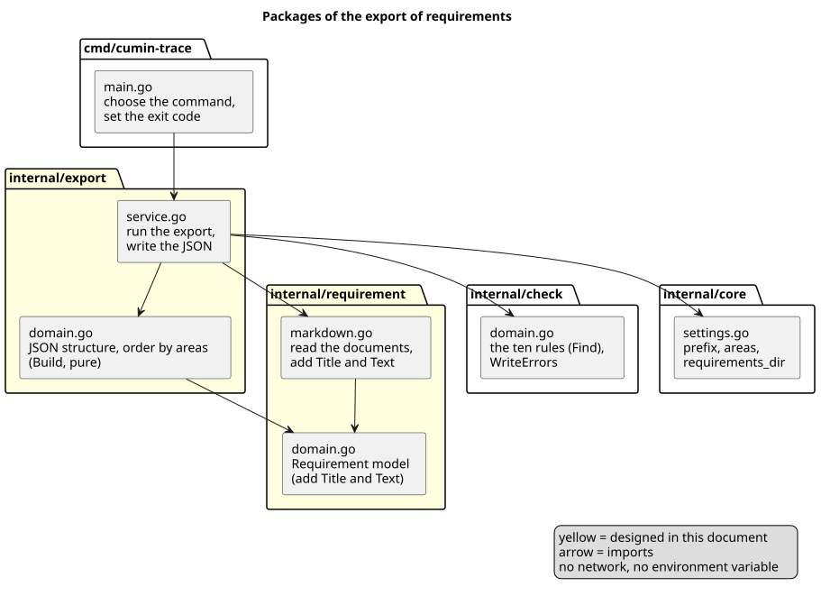
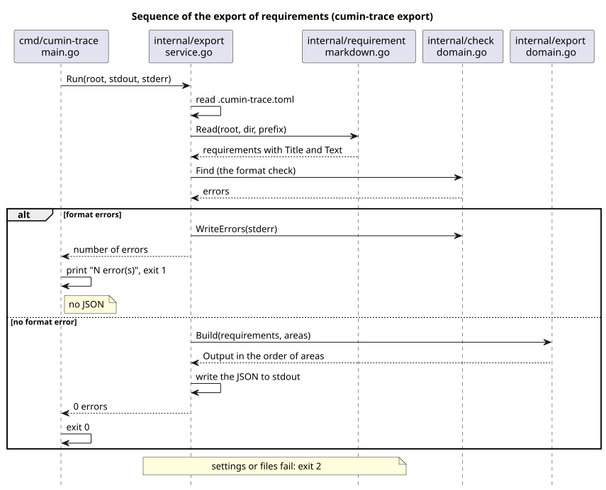

# 構造化データの出力の設計

`cumin-trace export` が、要件文書からタイトルと本文をどう読み、要件をどの形と順で JSON に出すかを決める。

## 要件

- [構造化データの出力](../../requirements/export/index.md)
  - `CTR-EXP-001` 出力する内容
  - `CTR-EXP-002` 同じ文書からは同じ出力
  - `CTR-EXP-003` 書式の誤りがあるとき
- [コマンド](../../requirements/command/index.md)
  - `CTR-CMD-001` コマンドの一覧 (`export` の行)
  - `CTR-CMD-003` 引数の誤り
- [書式検査](../../requirements/check/index.md)
  - `CTR-CHK-001` 検出するエラー (出力の前に適用する)
  - `CTR-CHK-004` 入力は要件文書だけ (`export` が適用する書式検査について)
- [要件の書き方](../../requirements/format/index.md)
  - `CTR-FMT-003` 要件は見出しで書く (タイトルと範囲)
  - `CTR-FMT-005` フィールド (本文の終わり)

## 実装の状況

いまのコードは、この設計のどれも持たない。次の Issue (#5 の実装Issue) が、この設計のとおりに作る。

| 部分 | 状況 |
|---|---|
| 要件のモデルの `Title` と `Text`、その読み方 (`internal/requirement/markdown.go`) | 未実装 |
| コマンド `cumin-trace export`、使い方の行、終了コード | 未実装 |
| JSON の形と並べ方 (`internal/export/domain.go`) | 未実装 |
| 書式のエラーでの停止 (`CTR-EXP-003`) | 未実装 |

## 全体像

[ソースコード全体構成](../../architecture/overview.md) の `internal/export` (未実装)、`internal/requirement`、`internal/check`、`internal/core` (設定) にあたる。

図の元ファイル: [export-packages.puml](export-packages.puml)

書式検査を先に済ませ、エラーがなければ JSON を書く (`CTR-EXP-003`)。

図の元ファイル: [export-sequence.puml](export-sequence.puml)

## 決めたこと

### 出力は、引数を取らないコマンド `cumin-trace export` で、JSON を標準出力に書く

終了コードと、エラーの書き方は `cumin-trace trace` と同じにする。

- 理由: 標準出力をリダイレクトすれば、ファイルにも書ける (`cumin-trace export > requirements.json`)。`trace` と同じ形なので、使う人が覚えることが増えない。
- 採らなかった案: 出力先のファイルを引数で受け取る。`trace` と同じく、リダイレクトで足りる。
- 細部: [コマンドと出力](command.md)

### タイトルと本文は、要件文書を読むときに一緒に読み、要件のモデルに持つ

`internal/requirement` の `Requirement` に `Title` と `Text` を足し、`markdown.go` が見出しと同じ走査で読む。どちらも、書いたままの Markdown である。

- 理由: 要件の見出しと範囲を見分ける規則は、書式検査と同じものを使う必要がある。読み方を2つ持つと、書式検査と出力で要件の境目が食い違う。
- 理由: サイトは本文を Markdown として表示する。強調やリンクを文字に変えると、もとの見え方に戻せない。
- 細部: [タイトルと本文の読み方](reading.md)

### 本文は、要件の見出しの次の行から、最初の見出し、区切り線、フィールドの前までとする

文書の最上位の見出し (子要件、次の要件、IDのない見出し)、`検証` か `状態` の項目、区切り線のうち、最初に来たものの前で本文が終わる。

- 理由: 要件の書き方は「見出し、本文、`検証` の行、区切り線」の順である。子を持つ要件では、本文の後ろに子要件の見出しが来る。最初に来たもので止めれば、どの書き方でも本文だけが残る。
- 採らなかった案: 要件の範囲から、子要件の範囲、フィールドの項目、区切り線の行を除いて、残りをつなぐ ([b084d07 の書式検査の設計](https://github.com/cloveclovedev/cumin-trace/blob/b084d07/docs/ja/designs/check.md))。`検証` の後ろの文と前の文が1つの本文につながり、書いた人の意図と離れる。
- 細部: [タイトルと本文の読み方](reading.md#本文)

### パッケージは `internal/export`

`internal/export/service.go` が設定と要件文書を読み、書式検査を適用し、JSON を書く。`internal/export/domain.go` が JSON の構造と並べ方を持つ。

- 理由: 1つの機能は1つのパッケージが持つ。`internal/trace` と同じ分け方である。
- 採らなかった案: `internal/check` に出力を足す。書式検査と出力は別のコマンドで、別の要件である。
- 細部: [コマンドと出力](command.md#パッケージとファイル)
