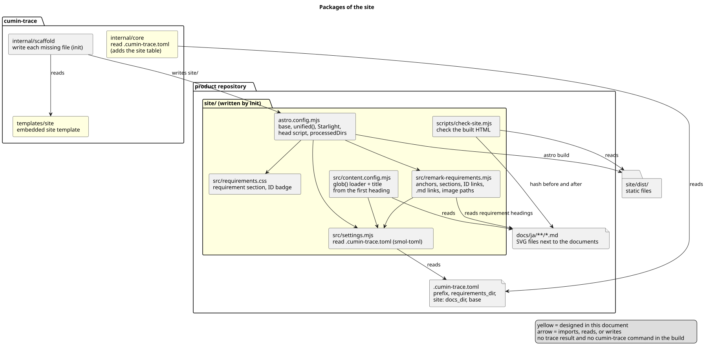
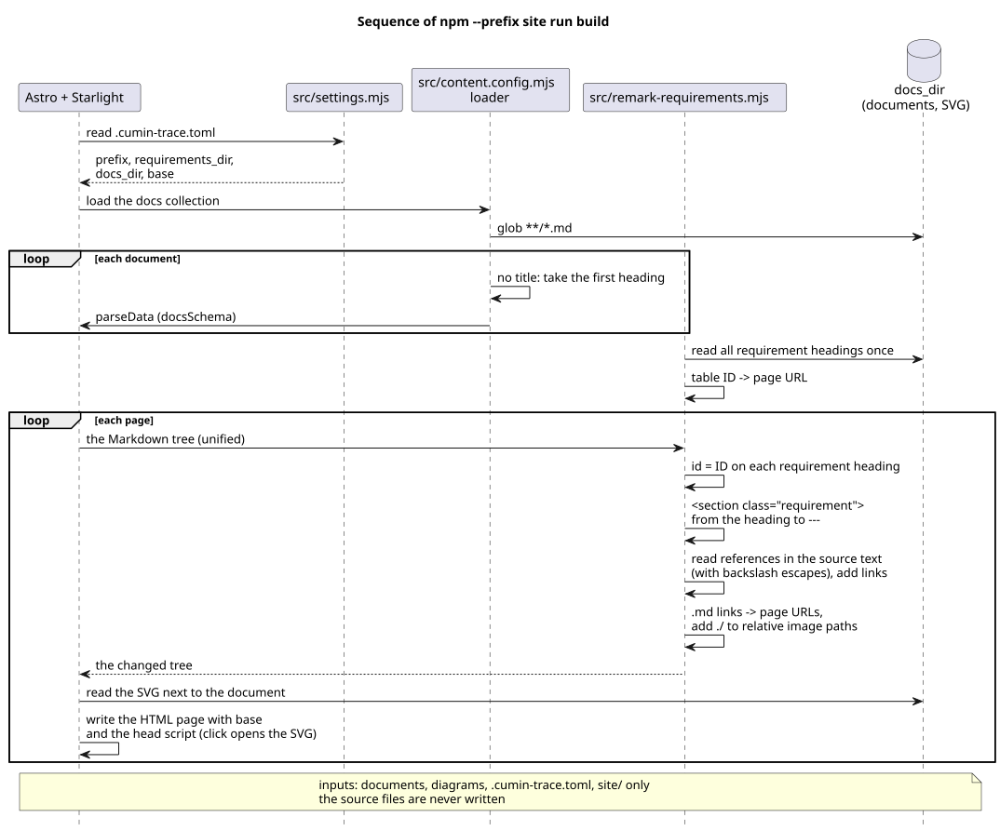

# サイトの設計

要件文書を Astro + Starlight のサイトとして表示する仕組みを決める。`cumin-trace init` がサイトのテンプレートを `site/` に書き、Starlight のビルドが、文書と図だけからページを作る。ダッシュボード (`CTR-DASH-001`) は、この文書では決めない。

## 要件

- [サイト](../../requirements/site/index.md)
  - `CTR-SITE-001` サイトのテンプレート ([ファイルと設定](files.md))
  - `CTR-SITE-002` 文書を書き換えずに表示する ([ビルド](build.md))
  - `CTR-SITE-003` 要件へのリンク ([ビルド](build.md))
  - `CTR-SITE-004` 図の表示 ([ビルド](build.md))
  - `CTR-SITE-005` 手元でのプレビュー ([ファイルと設定](files.md))
  - `CTR-SITE-006` 要件の区切りの表示 ([ビルド](build.md))
  - `CTR-SITE-007` 図の拡大 ([ビルド](build.md))
  - `CTR-SITE-008` 配信先で動く ([ファイルと設定](files.md))
  - `CTR-SITE-009` 文書だけから作る ([ビルド](build.md))
  - `CTR-SITE-010` 文書の間のリンク ([ビルド](build.md))
- [コマンド](../../requirements/command/index.md)
  - `CTR-CMD-001` コマンドの一覧 (`init` がサイトのテンプレートも書く)

## 全体像

[ソースコード全体構成](../../architecture/overview.md) の `internal/scaffold`、最上位の `templates` の `site/`、プロダクトのリポジトリの `site/` にあたる。黄色が、この文書で決めるものである。

図の元ファイル: [site-packages.puml](site-packages.puml)

図の元ファイル: [site-sequence.puml](site-sequence.puml)

## 公式文書の確認

Astro 7.4.0 と Starlight 0.42.6 に固定する (下の「バージョン」)。公式文書のサイトは最新版だけを示す。2026-10-17 に `npm view` で、最新版がこの2つであることを確かめてから読んだ。

| 事実 | 確かめたページ |
|---|---|
| Starlight は、すべてのページに `title` を求める | Starlight [Frontmatter Reference](https://starlight.astro.build/reference/frontmatter/) |
| `docs` のコレクションは `docsLoader()` と `docsSchema()` で定義する。既定では `src/content/docs/` の文書がページになる | Starlight [Manual Setup](https://starlight.astro.build/manual-setup/) |
| `glob()` の `base` は、`pattern` を解決するディレクトリである。ローダーの文脈の `parseData()` は、コレクションのスキーマでデータを確かめる | Astro [Content Loader API](https://docs.astro.build/en/reference/content-loader-reference/) |
| Astro 7 の既定の Markdown の処理系は Sätteri である。`@astrojs/markdown-remark` の `unified()` を `markdown.processor` に渡すと、remark と rehype のプラグインを使える。プラグインが付けた見出しの `id` は残る | Astro [Markdown](https://docs.astro.build/en/guides/markdown-content/) |
| Starlight の `customCss` で CSS を、`head` でタグを足せる。`markdown.processedDirs` で、`src/content/docs/` の外のディレクトリにも Starlight の Markdown の処理をかける | Starlight [Configuration Reference](https://starlight.astro.build/reference/configuration/) |
| `base` は、開発とビルドの両方で、ページと資産の根になる | Astro [Configuration Reference](https://docs.astro.build/en/reference/configuration-reference/) |
| Astro は Node.js `v22.22.0` 以上を求め、奇数のバージョンを対象にしない | Astro [Install and set up](https://docs.astro.build/en/install-and-setup/) |

上の表にない Astro と Starlight の振る舞いは、この文書では推測として書き、「推測」と記す。実装の Issue で、確認のコマンド (`npm run check-site`) で確かめる。

## 決めたこと

### テンプレートは `init` が `site/` に書く

`cumin-trace init` が、ほかのテンプレートに続けて、`site/` の下のファイルを書く。書き方は、ほかのテンプレートと同じく、足りないファイルだけを書き、上書きしない ([テンプレートの生成](../templates/index.md))。サイトのためのコマンドは足さない。

- 理由: `CTR-SITE-001` はテンプレートの生成を求め、`init` はすでに「足りないファイルだけを書く」仕組みを持つ。コマンドを足さなければ、`CTR-CMD-001` の表のコマンドは増えない。表の `init` の行に `CTR-SITE-001` を足すだけである。
- 採らなかった案: `cumin-trace site init` などの新しいコマンド。同じ書き方の仕組みが2つになる。
- 採らなかった案: `npm create astro` の Starlight のテンプレートを使わせ、手で直させる。ID のアンカーとリンクの部品を、プロダクトごとに書き写すことになる。
- 細部: [ファイルと設定](files.md)

### 設定は `.cumin-trace.toml` の `[site]` に置く

文書のディレクトリ (`docs_dir`、既定 `docs/ja`) と、サイトの base path (`base`、既定 `/`) を、`.cumin-trace.toml` の `[site]` の表に置く。サイトは、同じファイルの `prefix` と `requirements_dir` も読む。`internal/core` は、`[site]` を知っているキーとして受け付け、値を確かめる。

- 理由: `CTR-SITE-002` は「リポジトリの設定」を求める。接頭辞と要件のディレクトリはすでにこのファイルにある。base path をここに置くと、`site/` のファイルは、どのリポジトリでもテンプレートと同じになる。
- 採らなかった案: `site/astro.config.mjs` に定数で書く。このリポジトリの `site/` がテンプレートと違うファイルになり、ずれを確かめられない。
- 採らなかった案: 環境変数。手元のプレビューと配信で、値を2か所に書くことになる。
- 細部: [ファイルと設定](files.md)

### 文書は `src/content/docs/` に写さず、ローダーで直接読む

`site/src/content.config.mjs` の `docs` のコレクションは、Astro の `glob()` を包む小さなローダーで、`docs_dir` の下の `**/*.md` を読む。包むローダーは、`parseData()` に渡す前に、frontmatter に `title` がなければ、文書の最初の見出しの文字を `title` にする。スキーマは `docsSchema()` のままである。

- 理由: `CTR-SITE-002` は元のファイルを書き換えないことを求める。`parseData()` はスキーマを確かめる前に呼ばれるので、そこで `title` を足せば、Starlight の求める `title` が満たされる。写しを作らないので、プレビュー中の文書の変更がそのまま映る (推測)。
- 採らなかった案: ビルドの前に、frontmatter を足した写しを `src/content/docs/` に作る。写しを作る手順がビルドとプレビューの前に要り、写しと元がずれる。
- 採らなかった案: remark のプラグインで `data.astro.frontmatter.title` を足す。コレクションのスキーマはレンダリングより前にデータを確かめるので、`title` がないエラーが先に出る (推測)。
- 細部: [ビルド](build.md)

### ID のアンカー、参照のリンク、要件の枠は、1つの remark のプラグインで作る

`site/src/remark-requirements.mjs` が、要件の見出しに ID のアンカーを付け、要件を `<section>` で囲み、ID の参照をリンクにする。文書の間のリンク (`CTR-SITE-010`) も、同じプラグインで書き換える。参照を読む場所と4つの決まりは、書式検査と同じにする。参照は、テキストとコードスパンのノードの値 (表示される文字) で読む。Markdown の処理系は、`unified()` に切り替える。

- 理由: 値で読むのが最も簡単である。書式検査はエスケープの前の文字で読む ([文書の読み方](../check/reading.md)) ので、エスケープした ID だけは検査と結果が違いうる。このリポジトリの要件文書は ID をエスケープして書かないので、その違いを受け入れる。`unified()` にするのは、公式文書が remark のプラグインの使い方を `unified()` で示しているためである。
- 採らなかった案: ノードの元の文字の位置 (unist の `offset`) から元の文字を取り出し、検査と同じ文字で読んで、値の位置に写す。エスケープ、文字参照、行頭の空白を数える写し方が要るが、このリポジトリにはそれを要する文書がない。
- 採らなかった案: 既定の Sätteri の `mdastPlugins`。remark のプラグインと同じ構文木で動くことを、公式文書で確かめられなかった。
- 細部: [ビルド](build.md)

### 図は、文書の隣の SVG をそのまま使い、クリックで SVG のファイルを開く

画像のパスは、文書のファイルからの相対パスとして Astro が解決する。プラグインは、`./` も `../` もない相対パス (`site-build.svg`) に `./` を足す。本文の画像をクリックすると、1行のインラインのスクリプトが、その SVG のファイルを開く。ブラウザが SVG だけを元の大きさで表示する。npm のパッケージは足さない。

- 理由: `CTR-SITE-004` と `CTR-SITE-007` を、静的なファイルだけで満たす (`CTR-SITE-008`)。SVG は拡大しても文字が崩れない。
- 採らなかった案: `starlight-image-zoom` (0.16.2)。依存が1つ増え、画面の中に重ねて表示するので、横に長い図は画面の幅より大きくならない。
- 採らなかった案: 画像を、プラグインで SVG へのリンクで包む。Astro が出力に置いた画像の URL を、プラグインの段階では知らない (推測)。
- 採らなかった案: 画面に重ねて表示する、自分で書いた拡大表示の JavaScript。保守するコードが増える。
- 細部: [ビルド](build.md)

### バージョンは正確な値で固定し、cumin-trace のリリースと一緒に上げる

`site/package.json` は、`astro` を `7.4.0`、`@astrojs/starlight` を `0.42.6`、`smol-toml` を `1.9.1` に、範囲 (`^`) なしで書く。Node.js は、`site/.node-version` に `24` を書き、`engines` に `>=22.22.0` を書く。プロダクトは、最初の `npm install` で作る `site/package-lock.json` をコミットする。上げるときは、Maintainer が、このリポジトリのテンプレートと `site/` を同じ Pull Request で上げ、`npm run check-site` を通す。すでにテンプレートを書いたプロダクトは、`init` が上書きしないので、自分で上げる。

- 理由: `technology.md` は、固定したバージョンの公式文書を読むことを求める。範囲で書くと、`npm install` のたびに読むべき文書が変わる。Node.js の `24` は偶数のバージョンで、Astro の求める `v22.22.0` 以上に入る。`smol-toml` は `.cumin-trace.toml` を読むためで、依存のない小さな TOML のパーサである。
- 採らなかった案: `^` の範囲。プロダクトごとに違うバージョンが入る。
- 採らなかった案: Dependabot。設定は `.github/` に置き、Agent が書けない。必要になれば Maintainer が足す。
- 採らなかった案 (Docker): サイトを Docker のコンテナでビルドする。要求Issueの制約 (Node と npm でビルドする) に合わない。

### このリポジトリの `site/` は `init` で書き、テンプレートとの一致をテストで確かめる

このリポジトリも、`go run ./cmd/cumin-trace init CTR` で書いた `site/` をコミットする。`.cumin-trace.toml` に `[site]` の `base = "/cumin-trace/"` を書く。Go のテストが、`site/` の各ファイルが `templates/site/` と同じであることを確かめる。

- 理由: このリポジトリのサイトが、プロダクトに書くものと同じテンプレートで動くことを、毎回確かめられる。
- 採らなかった案: `templates/site/` から直接ビルドする。リポジトリの最上位が `../../` になり、プロダクトの形と違う。
- 細部: [ファイルと設定](files.md)

### サイトの振る舞いは、1つのコマンドで確かめる

`npm --prefix site run check-site` が、文書のハッシュを取り、サイトをビルドし、もう一度ハッシュを取り、出力の HTML を調べる。調べるのは、タイトル、アンカー、リンクの行き先、図のファイル、要件の枠、元の文書が変わらないことである。Node.js の標準の機能だけで書く。

- 理由: `CTR-SITE-001` から `CTR-SITE-010` の検証はすべて `demo` で、毎回ブラウザで見るのは繰り返せない。HTML の形で確かめられる部分を、どの手元でも同じ結果になるコマンドにする。
- 採らなかった案: Playwright でブラウザを動かす。大きな依存が増える。クリックの見た目は `demo` で Maintainer が見る。
- 細部: [ファイルと設定](files.md)
