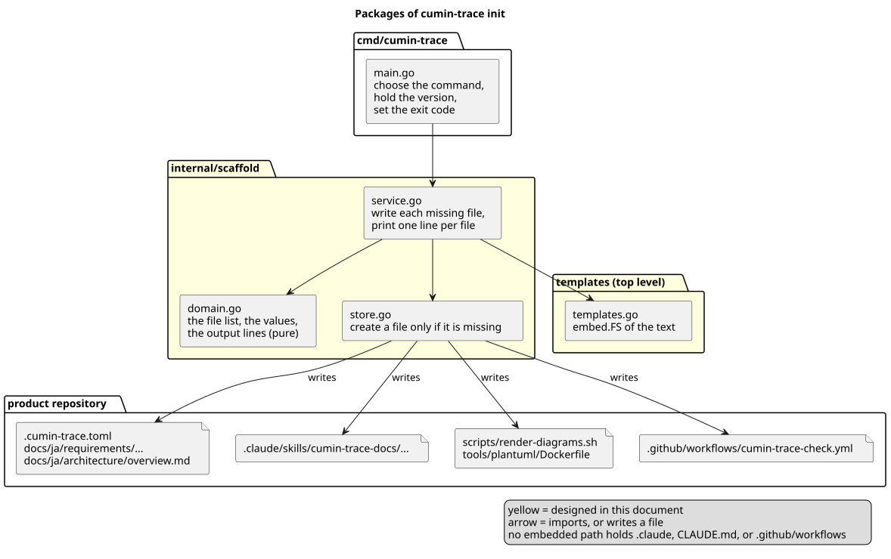
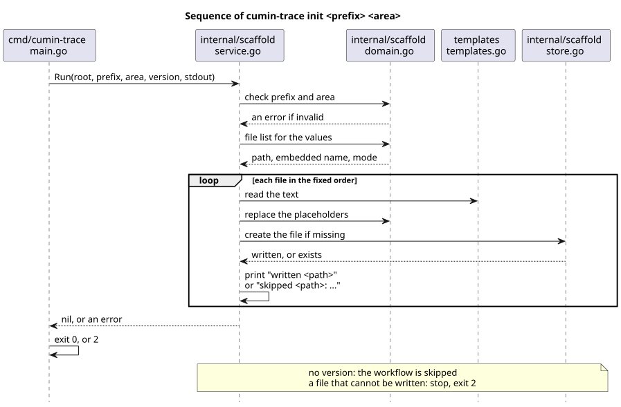

# テンプレートの生成の設計

`cumin-trace init` が、プロダクトのリポジトリに何を、どう書くかを決める。書くものは、要件文書とソースコード全体構成のテンプレート、文書を書くための skill、図を描画するスクリプト、Pull Request の check の workflow である。

## 要件

- [テンプレートと skill](../../requirements/templates/index.md)
  - `CTR-TPL-001` テンプレートの生成
  - `CTR-TPL-002` 概要のテンプレート
  - `CTR-TPL-003` カテゴリごとの要件のテンプレート
  - `CTR-TPL-004` 技術要素のテンプレート
  - `CTR-TPL-007` 用語集のテンプレート
  - `CTR-TPL-008` 設計文書のテンプレート
  - `CTR-TPL-009` ソースコード全体構成のテンプレート
  - `CTR-TPL-005` 文書を書くための skill
  - `CTR-TPL-006` 図の描画
- [書式検査](../../requirements/check/index.md)
  - `CTR-CHK-005` Pull Request の check

## 全体像

[ソースコード全体構成](../../architecture/overview.md) の `cmd/cumin-trace`、`internal/scaffold`、最上位の `templates` にあたる。

図の元ファイル: [templates-packages.puml](templates-packages.puml)

図の元ファイル: [templates-sequence.puml](templates-sequence.puml)

## 決めたこと

### コマンドは `cumin-trace init <prefix> [<area>]`

接頭辞を必須の引数で、最初のカテゴリを1つ、省略できる引数で受け取る。どちらも位置で決まる。現在のディレクトリに書く。

- 理由: 接頭辞はIDのすべてに現れるので、最初に決める。カテゴリは、`init` を実行するときにはまだ決まっていないことが多い。既定値で書くと、プロダクトはあとでIDと設定を書き換えることになる。
- 採らなかった案: 引数なしで、`PC` と `TASK` を書く。書式の例と同じ値になるが、どのプロダクトでも書き換えが要る。
- 採らなかった案: カテゴリも必須にする。カテゴリが決まる前に `init` を実行できない。
- 採らなかった案: `--prefix` と `--area` のフラグ。引数は2つだけで、順に意味が決まるので、フラグにする利点がない。
- 細部: [コマンド](command.md)

### 足りないファイルだけを書き、上書きしない

決まった順にファイルを1つずつ書く。すでにあるファイルは変えず、ファイルごとに `written <path>` か `skipped <path>: ...` を1行出す。ファイルは「なければ作る」の1回の操作で作る。

- 理由: `CTR-TPL-001` が上書きを禁じる。確かめてから書く2回の操作では、その間に作られたファイルを上書きしうる。
- 採らなかった案: すでにあるファイルが1つでもあれば、何も書かずに失敗する。あとから増えたテンプレート (skill など) を、すでに始めたリポジトリに足せない。
- 細部: [コマンド](command.md)

### 設定とカテゴリのページは、引数の値で書く

カテゴリがないときは、`.cumin-trace.toml` に `prefix` と `areas = []` を書き、カテゴリのページと図の例は書かない。最初のカテゴリのページは、カテゴリのテンプレートを持つ skill で書く。書式検査は、空の `areas` を受け付け、要件のない文書をエラーなしで通す。そのために #34 で `internal/core/settings.go` を変える ([設定ファイル](../check/settings.md))。

カテゴリがあるときは、`.cumin-trace.toml` に、その `prefix` と、その1つのカテゴリだけの `areas` を書く。カテゴリのページは `docs/ja/requirements/<カテゴリの小文字>/index.md` で、記入例のIDは `<prefix>-<area>-001` である。同じディレクトリに、図の例 `overview.puml` と、その描画の `overview.svg` を書く。`init` が用意するのは最初のカテゴリだけで、2つ目からのカテゴリは skill で書く。

- 理由: `init` が知るのはカテゴリの略号だけで、カテゴリの名前 (このリポジトリの `TPL` に対する `templates`) は知らない。略号から決まる名前は、その小文字だけである。ディレクトリ名は、Maintainer があとで変えてよい。書式検査は、カテゴリとディレクトリの名前が合っているかを確かめない ([設定ファイル](../check/settings.md))。生成した直後に、書式検査がエラーなしで通る (`CTR-TPL-001`)。
- 採らなかった案: ディレクトリ名をカテゴリの略号のまま大文字にする。ほかのディレクトリ (`docs/`、`requirements/`) が小文字なので、1つだけ大文字になる。
- 採らなかった案: カテゴリがないときに、`areas` を書かない。キーがないことと、カテゴリがまだないことの区別がつかない。
- 採らなかった案: カテゴリの名前を3つ目の引数で受け取る。最初の1つのカテゴリのためだけに、引数が増える。
- 細部: [ファイルと埋め込み](files.md)

### 書く文は、最上位の1つのパッケージに埋め込む

最上位のディレクトリ `templates/` を Go のパッケージ `templates` にし、`embed.FS` で持つ。埋め込むパスには、`.claude` の部分、`CLAUDE.md` という名前のファイル、`.github/workflows/` を入れない。書き出す先のパスは、`internal/scaffold/domain.go` の表で決める。

- 理由: それらのパスは、Agent が変えられない (保護されたパス、または `.github/workflows/`)。埋め込む側に置かなければ、Agent が文を直せる。
- 採らなかった案: 書き出す先と同じパスで埋め込む。Agent が skill と workflow を直せなくなる。
- 細部: [ファイルと埋め込み](files.md)

### 差し込む値は、決まった文字列の置き換えにする

`{{prefix}}`、`{{area}}`、`{{area_dir}}`、`{{version}}` の4つを、`strings.Replacer` で置き換える。

- 理由: workflow は `${{ ... }}` を含むので、`text/template` の区切りと衝突する。値は4つだけで、条件や繰り返しは要らない。
- 採らなかった案: `text/template`。workflow の `${{ ... }}` をすべて書き換えて逃がす必要がある。
- 細部: [ファイルと埋め込み](files.md)

### skill は `.claude/skills/cumin-trace-docs/` に、同じ埋め込みのファイルから書く

`SKILL.md` と `templates/` の9つのテンプレートを書く。7種類 (`CTR-TPL-001`) のテンプレートは、`docs/` に書くものと同じ埋め込みのファイルを、同じ値で置き換えて書く。設計文書の入口と細部のテンプレートは、skill にだけ書く。

- 理由: `CTR-TPL-005` は、skill のテンプレートの文が生成するものと同じであることを求める。同じファイルから書けば、ずれようがない。
- 採らなかった案: skill 用に別のファイルを持つ。文がずれても気付けない。
- 細部: [ファイルと埋め込み](files.md)

### 図のスクリプトは、cumin-works と同じ使い方にする

`scripts/render-diagrams.sh` と `tools/plantuml/Dockerfile` を書く。引数なし、`<in.puml> <out.svg>`、`--check <base>` の3つの使い方と、Docker のイメージ (`plantuml/plantuml:1.2025.4` に日本語のフォント) を cumin-works と同じにする。

- 理由: `CTR-TPL-006` が、cumin-works と同じ使い方を求める。同じイメージなら、どちらで描画しても同じ SVG になる。
- 採らなかった案: Docker を使わずに PlantUML の jar を動かす。Java の版で SVG が変わりうる。
- 細部: [ファイルと埋め込み](files.md)

### check の workflow は、固定した版のリリースのバイナリを使う

`.github/workflows/cumin-trace-check.yml` は、このリポジトリの GitHub のリリースから、決まった版の Linux (amd64) のバイナリと `checksums.txt` を `gh release download` で取り、チェックサムを確かめてから `check` を実行する。Go は要らない。版は、`init` を実行したバイナリの版である。版を持たないバイナリは、workflow を書かずに `skipped` を出す。

- 理由: `gh` は GitHub のランナーに最初から入っていて、`GH_TOKEN` だけで動く。版を固定すると、cumin-trace の新しいリリースで check の結果が黙って変わらない。
- 採らなかった案: workflow で `go install ...@<version>`。実行のたびにソースを取ってビルドする。
- 採らなかった案: `curl` でリリースの URL から取る。URL の形を自分で組み立てることになり、`gh` で足りる。
- 採らなかった案: 版のないバイナリは `latest` を書く。新しいリリースで結果が変わり、版を固定する意味がなくなる。
- 細部: [リリースと workflow](release.md)

### このリポジトリは、版のタグでリリースのバイナリを公開する

`v<数>.<数>.<数>` の形のタグ (プレリリースを除く) を push すると、workflow がテストし、4つの OS と CPU の組のバイナリをビルドし、`checksums.txt` を添えて GitHub のリリースにする。バイナリは、`-ldflags "-X main.version=<タグ>"` で自分の版を知る。この workflow は Agent が書けない場所に置くので、Maintainer が [リリースと workflow](release.md) の全文を足す。

- 理由: check の workflow が Go なしで動くには、ビルド済みのバイナリが要る。
- 採らなかった案: Go 1.24 からの、VCS のタグによる版の自動の記録だけに頼る。checkout の取り方で、タグが見えないことがある。`go install ...@<version>` で入れたバイナリのためにだけ、それも読む。
- 細部: [リリースと workflow](release.md)
