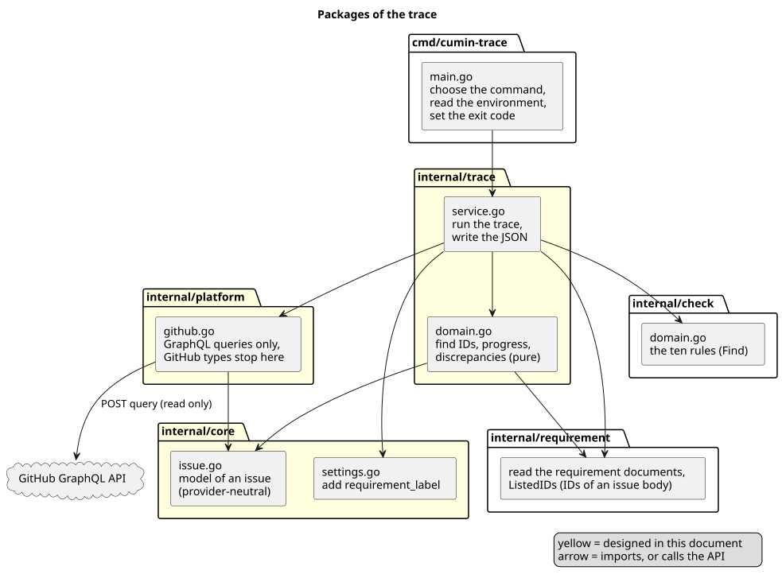
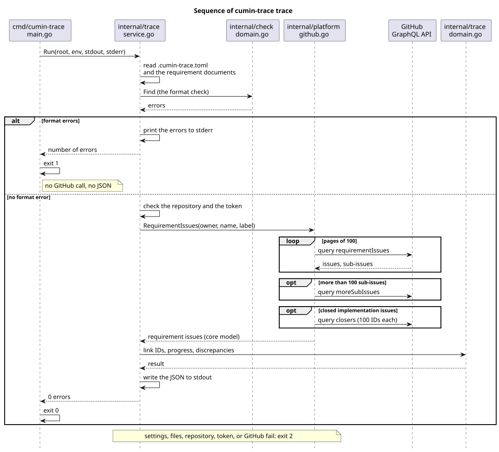

# 要件と要求Issueの対応づけの設計

`cumin-trace trace` が、要件文書と GitHub の要求Issueをどう読み、進捗と不整合をどう決めて JSON に出すかを決める。

## 要件

- [GitHub との対応づけ](../../requirements/trace/index.md)
  - `CTR-TRC-001` 要求Issueの見分け方
  - `CTR-TRC-002` 要件と要求Issueの結び付き
  - `CTR-TRC-003` 実装Issueと Pull Request
  - `CTR-TRC-004` 進捗 (`CTR-TRC-004.1` 未起票、`CTR-TRC-004.2` 進行中、`CTR-TRC-004.3` 完了)
  - `CTR-TRC-005` 子を持つ要件の進捗
  - `CTR-TRC-006` 不整合の報告
  - `CTR-TRC-007` GitHub には書き込まない
  - `CTR-TRC-008` 結果の出力
  - `CTR-TRC-009` 書式の誤りがあるとき
- [コマンド](../../requirements/command/index.md)
  - `CTR-CMD-001` コマンドの一覧
  - `CTR-CMD-003` 引数の誤り
- [書式検査](../../requirements/check/index.md)
  - `CTR-CHK-001` 検出するエラー (対応づけの前に適用する)
- [構造化データの出力](../../requirements/export/index.md)
  - `CTR-EXP-002` 同じ文書からは同じ出力 (要件の並べ方を借りる)

## 全体像

[ソースコード全体構成](../../architecture/overview.md) の `internal/trace`、`internal/platform`、`internal/core` (設定) にあたる。

図の元ファイル: [trace-packages.puml](trace-packages.puml)

書式検査を先に済ませ、エラーがなければ GitHub を読む (`CTR-TRC-009`)。

図の元ファイル: [trace-sequence.puml](trace-sequence.puml)

## 決めたこと

### 要件と要求Issueの対応づけは、独立したコマンド `cumin-trace trace`

引数を取らない。結果の JSON は標準出力に書く。

- 理由: `check` と `export` は token もネットワークも要らない (`CTR-CHK-004`)。GitHub を読むコマンドを分けると、その2つは手元でも Pull Request の check でも、token なしで動き続ける。
- 採らなかった案: `export` に GitHub の読み取りを足す。`CTR-EXP-002` (同じ文書からは同じ出力) と、読んだ時刻を持つ出力 (`CTR-TRC-008`) が両立しない。
- 採らなかった案: 出力先のファイルを引数で受け取る。標準出力をリダイレクトすれば足りる。
- `CTR-CMD-001` の表は、`trace` の行を持つ。
- 細部: [コマンドと出力](command.md)

### 設定は1つのキーを足す。リポジトリと token は環境から決める

`.cumin-trace.toml` に `requirement_label` (既定 `cumin/type/requirement`) だけを足す。読むリポジトリは、環境変数 `GITHUB_REPOSITORY`、なければ現在のディレクトリの `origin` の remote から決める。token は環境変数 `GITHUB_TOKEN` から読む。

- 理由: 要求Issueは、要件文書と同じリポジトリにある。GitHub Actions は `GITHUB_REPOSITORY` を必ず渡し、手元のクローンは `origin` を持つので、設定に書かなくても決まる。token はファイルに書かない (`CTR-TRC-007`)。
- 採らなかった案: 設定の `repository` キー。リポジトリの名前を変えたり fork したりすると、設定と実際のリポジトリが食い違う。
- 細部: [コマンドと出力](command.md)

### GitHub は GraphQL API だけで読む

読むのは、要求Issueの一覧と sub-issue の一覧 (1種類の問い合わせ)、閉じた実装Issueを閉じた Pull Request (もう1種類の問い合わせ) である。問い合わせは `query` だけで、`mutation` を持たない。

- 理由: ラベル、閉じた理由、マイルストーン、sub-issue を、100件の要求Issueにつき1回の呼び出しで読める。REST API では、要求Issueごとに sub-issue の呼び出しが、実装Issueごとに timeline の呼び出しが要る。
- 細部: [GitHub の読み方](github.md)

### IDは、本文の `## Requirements` の節の、箇条書きの項目の先頭だけから探す

要求Issueの本文を `goldmark` で読み、`## Requirements` の節の項目の先頭のIDだけを対応にする (`CTR-TRC-002`)。読む関数は `internal/requirement/markdown.go` に置き、IDの形は `IDForm` で確かめる。

- 理由: 節と項目とコードブロックの区別には、Markdown の構文木が要る。要件文書と同じ読み方 (CommonMark、拡張なし) で、GitHub での見え方と合う。`goldmark` の型は `markdown.go` の外に出さない ([パッケージとファイル](../check/packages.md))。
- 採らなかった案: 本文の全体に `IDForm.References` を適用する。ほかの節の説明やコードブロックの例のIDも、対応になってしまう。
- 細部: [進捗と不整合](rules.md)

### パッケージは `internal/trace` と `internal/platform`

GraphQL の client は `internal/platform/github.go` に置き、その中で定義した Go の型 (GraphQL の型ではない) を返す。Issueのモデルは `internal/trace/domain.go` に置き、`internal/trace/convert.go` が `internal/platform` の型からモデルに変える。

- 理由: プラットフォームのパッケージは具体的な型を返し、機能ごとに自分のモデルへ変える。GraphQL の型はプラットフォームで止まり、機能の規則 (`domain.go`) はほかのパッケージに依存しない。ほかの機能も、あとで同じ client で GitHub を読める。
- 採らなかった案: 共有のモデルを `internal/core` に置く。使うのは対応づけだけで、プロバイダを知らない土台ではない。
- 採らなかった案: `internal/trace` が持つ interface。2つ目の実装か、テストの本当の必要が出るまで作らない。テストは偽の GitHub の後ろに本物の client を置く。interface は、あとで `internal/trace` の側に、`internal/platform` を変えずに足せる。
- 細部: [パッケージとファイル](packages.md)
