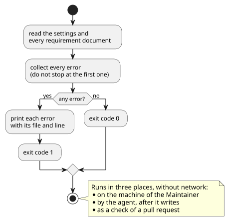

# 検査

要件文書が [書式](format.md) に沿っているかを、機械的に確かめるための要件を定める。

## 全体像

検査は、すべての文書を読んでエラーをまとめて報告し、終了コードで結果を返す。Maintainer の手元、Agent が書いた直後、Pull Request の check の3か所で、同じ検査が動く。

図の元ファイル: [check-flow.puml](check-flow.puml)

## 要件

### `CTR-CHK-001` 検出するエラー

`cumin-trace check` は、次のエラーを検出する。

| エラー | 関係する書式の要件 |
|---|---|
| IDの形式が正しくない | CTR-FMT-002 |
| 同じIDが2か所以上にある | CTR-FMT-003 |
| 子の要件が、親の見出しの外にある | CTR-FMT-004 |
| 検証の書き始めが、4つの方法のどれでもない | CTR-FMT-006 |
| 子を持たない要件に、検証がない | CTR-FMT-007 |
| 状態に、廃止以外が書いてある | CTR-FMT-008 |
| 存在しないIDを参照している | CTR-FMT-010 |
| 廃止した要件を、置き換え先の指定以外で参照している | CTR-FMT-010 |
| 設定にない領域のIDがある | CTR-FMT-011 |

- 検証: test。エラーの種類ごとに、そのエラーを1つだけ含む文書で確かめる

---

### `CTR-CHK-002` エラーの報告

検査は、最初のエラーで止まらず、すべてのエラーを報告する。エラーごとに、ファイル、行番号、ID、エラーの内容を示す。

- 検証: test。2つのエラーを含む文書で、2つとも報告される

---

### `CTR-CHK-003` 終了コード

エラーが1つでもあれば、終了コードは 0 以外になる。エラーがなければ 0 になる。

- 検証: test。エラーのある文書と、ない文書で確かめる

---

### `CTR-CHK-004` ネットワークを使わない

検査は、ネットワークに接続せずに動く。GitHub の token も要らない。

- 検証: test。ネットワークを使わないテストで、検査が通る

---

### `CTR-CHK-005` Pull Request の check

cumin-trace は、Pull Request で検査を実行する GitHub Actions の workflow を、製品リポジトリに生成する。

- 検証: demo。検証用のリポジトリで、エラーのある Pull Request の check が失敗する
