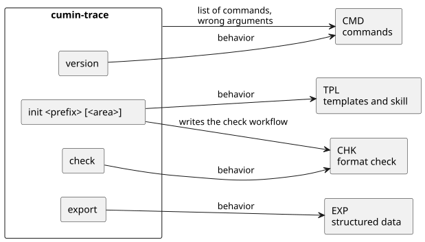

# コマンド

cumin-trace のコマンドの一覧と、すべてのコマンドに共通する約束を定める。各コマンドの振る舞いは、そのコマンドの機能のカテゴリで定める。機能のカテゴリを持たないコマンド (`version`) だけは、このページで振る舞いを定める。

## 全体像

cumin-trace は1つのバイナリで、最初の引数のコマンドで機能を選ぶ。

図の元ファイル: [command-areas.puml](command-areas.puml)

## 要件

### `CTR-CMD-001` コマンドの一覧

cumin-trace は、次のコマンドを持つ。

| コマンド | すること | 振る舞いの要件 |
|---|---|---|
| `init <接頭辞> [<カテゴリ>]` | テンプレート、skill、図の描画のスクリプト、Pull Request の check の workflow を生成する | CTR-TPL-001、CTR-TPL-005、CTR-TPL-006、CTR-CHK-005 |
| `check` | 書式検査をする | CTR-CHK-001 |
| `export` | 要件を JSON で出力する | CTR-EXP-001 |
| `version` | バージョンを表示する | CTR-CMD-002 |

- 検証: `inspection` 使い方の行に、この表のコマンドがすべて出る

---

### `CTR-CMD-002` バージョンの表示

`cumin-trace version` は、バイナリのバージョンを1行で標準出力に出し、終了コード 0 で終わる。リリースのビルドではタグのバージョンを出す。バージョンのないビルドでも、バージョンがないことがわかる1行を出す。

- 検証: `test` バージョンを設定したビルドと、設定しないビルドで確かめる

---

### `CTR-CMD-003` 引数の誤り

コマンドがないとき、知らないコマンドのとき、引数の数が合わないときは、使い方を標準エラー出力に出し、ファイルを何も書かずに、0 以外の終了コードで終わる。

- 検証: `test` 3つの場合で、使い方が出て、ファイルが増えず、終了コードが 0 以外になる

## 未決事項

- 対応づけ、サイト、ダッシュボードのコマンドの名前と引数。それぞれのカテゴリで決めたら、`CTR-CMD-001` の表に足す。
