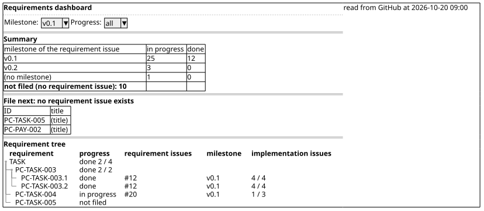
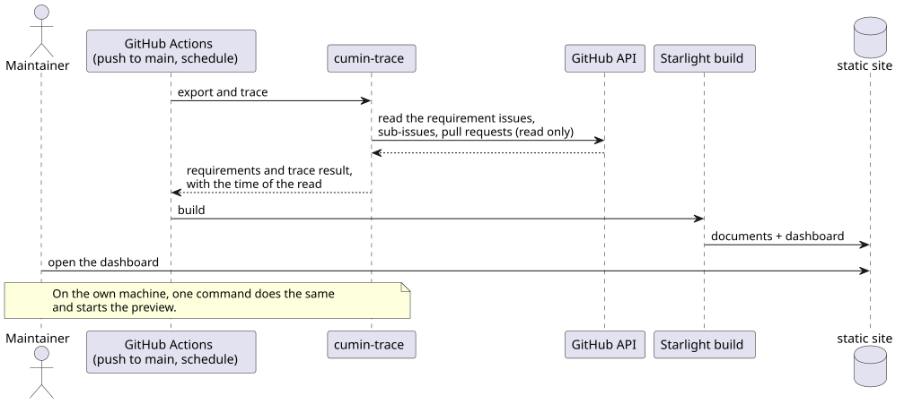

# ダッシュボード

要件の全体像と、要件 → 要求Issue → 実装Issue の進み具合を、1ページで見るための要件を定める。

## 全体像

ダッシュボードは、サイトの中の1ページである。上から、集計、次に起票する要件、要件の木の順に並ぶ。マイルストーンは、要件文書ではなく、要求Issueに付いているものを使う。

図の元ファイル: [dashboard-wireframe.puml](dashboard-wireframe.puml)

ダッシュボードは静的なページで、サイトをビルドするときに作られる。表示されるのは、最後に GitHub を読んだ時点の状態である。

図の元ファイル: [dashboard-update.puml](dashboard-update.puml)

## 要件

### `CTR-DASH-001` 要件の木

要件を、領域、要件、子の要件の木として表示する。要件ごとに、進み具合、対応する要求Issueとそのマイルストーン、実装Issueの数 (閉じた数 / 全体の数) を示す。廃止した要件は表示しない。

- 検証: `demo` この文書群の要件で確かめる

---

### `CTR-DASH-002` マイルストーンごとの集計

ページの先頭に、集計を表示する。未起票の要件の数と、要求Issueのマイルストーンごとの、進行中と完了の要件の数を示す。マイルストーンのない要求Issueに対応する要件も、1つの行として集計する。

- 検証: `demo` 集計の数が、要件の木の表示と一致する

---

### `CTR-DASH-003` 次に起票する要件

未起票の要件を、一覧で表示する。Maintainer が次に要求Issueを書くときの出発点になる。この一覧が空であれば、要件文書に書いたことは、すべて要求Issueになっている。

- 検証: `demo` 要求Issueのない要件が一覧に出て、要求Issueを書くと一覧から消える

---

### `CTR-DASH-004` 絞り込み

マイルストーンと進み具合で、要件の木を絞り込める。

- 検証: `demo` マイルストーンを v0.1、進み具合を進行中にして、該当する要件だけが残る

---

### `CTR-DASH-005` リンク

要件からは、サイトの中のその要件へリンクする。要求Issueと実装Issueからは、GitHub のそのIssueへリンクする。

- 検証: `demo` それぞれのリンクをクリックして、移動先を確かめる

---

### `CTR-DASH-006` 読んだ時刻の表示

GitHub を読んだ時刻を表示する。GitHub を読めなかったときは、進み具合の代わりに「読めていない」と表示し、要件の木は表示する。

- 検証: `demo` token を設定せずにビルドして確かめる

---

### `CTR-DASH-007` 静的なページ

ダッシュボードは静的なページとして作る。表示のためのサーバは持たない。

- 検証: `inspection` ビルドの出力がファイルだけである

---

### `CTR-DASH-008` 自動での更新

cumin-trace は、main への push と定期実行でサイトをビルドし直す GitHub Actions の workflow の例を提供する。ビルドしたサイトをどこに置くかは、例に含めない。

- 検証: `inspection` workflow の例を読んで確かめる
