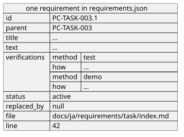

# 構造化データの出力

要件文書から読み取った要件を、ほかのツールや Agent が使える形で出力するための要件を定める。出力したデータは生成物であり、人は編集しない。

## 全体像

1つの要件は、次のようなデータになる。

図の元ファイル: [export-json.puml](export-json.puml)

## 要件

### `CTR-EXP-001` 出力する内容

`cumin-trace export` は、すべての要件を JSON で出力する。要件ごとに、ID、親のID、タイトル、本文、検証の一覧 (方法と確かめ方)、状態、置き換え先、ファイル、行番号を持つ。廃止した要件も出力する。

- 検証: `test` 親子のある要件と廃止した要件を含む文書で、出力を確かめる

---

### `CTR-EXP-002` 同じ文書からは同じ出力

同じ文書からは、常に同じ JSON を出力する。要件の順番は、設定に書いたカテゴリの順、その中では文書に書いた順とする。出力した日時のように、実行のたびに変わる値は含めない。

- 検証: `test` 2回出力して、内容が一致する
