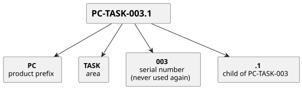
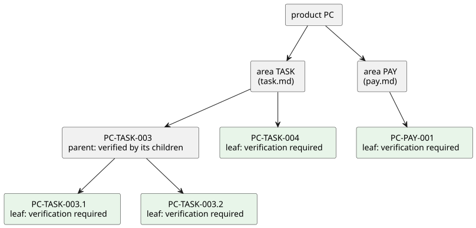

# 要件文書の書式

製品リポジトリの要件文書を、人にも cumin-trace にも読める形で書くためのルールを定める。この文書群も同じ書式で書いている。

## 考え方

- 1つのIDは、真偽を確かめられる1つのルールに対応する。受け入れ確認の1行と同じ粒度である。
- 要件は見出しで書く。背景や理由、例、図は、IDを持たない普通の文章として自由に書いてよい。cumin-trace はそれらを読まない。
- 要件の状態は増やさない。main にある要件はすべて有効で、下書きは merge 前のブランチにある。文書に書く状態は「廃止」だけである。
- 進み具合は文書に書かない。cumin-trace が GitHub から導く ([GitHub との対応づけ](trace.md))。

## 要件の書き方

1つの要件は、IDで始まる見出し、本文、フィールドの箇条書きの3つからなる。

```markdown
### PC-TASK-003 証拠の出し直し

タスク実行者は、期日前に限り、証拠を出し直せる。

#### PC-TASK-003.1 出し直しの回数

出し直せるのは最大N回である。Nの既定値は1とする。

- 検証: test。N+1回目の出し直しが拒否される
- 対象: v0.1

#### PC-TASK-003.2 期日後の出し直し

期日を過ぎたら、出し直しは受け付けない。

- 検証: test。期日後の出し直しが拒否される
- 対象: v0.1
```

IDは、製品、領域、連番、子の番号を順につないだものである。



図の元ファイル: [format-id.puml](format-id.puml)

要件は、製品、領域、要件、子の要件という木になる。検証を書くのは、木の葉にあたる要件である。



図の元ファイル: [format-tree.puml](format-tree.puml)

要件は、ブランチで書かれ、merge されて有効になり、不要になったら廃止される。廃止しても文書からは消さない。


図の元ファイル: [format-lifecycle.puml](format-lifecycle.puml)

## 要件

### CTR-FMT-001 要件文書の場所と形式

要件文書は Markdown で書き、製品リポジトリの設定で指定したディレクトリに置く。既定のディレクトリは `docs/ja/requirements/` とする。frontmatter は書かなくてよい。

- 検証: test。frontmatter のない文書から要件を読み取れる
- 対象: v0.1

### CTR-FMT-002 IDの形式

IDは `<製品>-<領域>-<連番>` の形式とする。製品と領域は英大文字と数字、連番は3桁の数字である。

- 検証: test。形式に合わないIDをエラーにする
- 対象: v0.1

### CTR-FMT-003 要件は見出しで書く

要件は、IDで始まる見出しとして書く。IDのあとに空白を1つ置き、要件のタイトルを続ける。見出しのレベルは問わない。その見出しから、同じレベルか上のレベルの次の見出しまでが、その要件の範囲である。

- 検証: test。見出しのレベルが違う要件を、どちらも読み取れる
- 対象: v0.1

### CTR-FMT-004 子の要件

子の要件のIDは、親のIDに `.<番号>` を付けたものとする。子の要件は、親の見出しの下に、1つ深いレベルの見出しで書く。

- 検証: test。親の見出しの外にある子の要件をエラーにする
- 対象: v0.1

### CTR-FMT-005 フィールド

要件のフィールドは `検証`、`対象`、`状態` の3つとする。要件の範囲の中に、`- 検証: ...` のように箇条書きで書く。

- 検証: test。3つのフィールドを読み取れる。ほかの名前の箇条書きは本文として扱う
- 対象: v0.1

### CTR-FMT-006 検証の方法

`検証` は、`test`、`demo`、`inspection`、`analysis` のいずれかで書き始め、続けて確かめ方を1文で書く。

| 方法 | 意味 | 例 |
|---|---|---|
| `test` | 自動テストで確かめる | 受け入れテスト |
| `demo` | 人か Agent が実際に動かして確かめる | live scenario、画面の操作 |
| `inspection` | 文書、設定、コードを読んで確かめる | 権限の一覧の確認、レビュー |
| `analysis` | 計算や調査で確かめる | 費用の見積もり、規約の確認 |

- 検証: test。4つ以外の語で始まる検証をエラーにする
- 対象: v0.1

### CTR-FMT-007 検証が必要な要件

子を持たない要件には `検証` を必ず書く。子を持つ要件は、子の検証で確かめるので、書かなくてよい。

- 検証: test。検証のない、子を持たない要件をエラーにする
- 対象: v0.1

### CTR-FMT-008 対象のバージョン

`対象` には、その要件を実現するバージョンを書く (例: `v0.1`)。書かなかった要件は、対象が未定として扱う。

- 検証: test。対象のない要件を、未定として読み取れる
- 対象: v0.1

### CTR-FMT-009 廃止

`状態` に書けるのは `廃止` だけである。置き換え先の要件があるときは `廃止。<ID> に置き換え` と書く。廃止した要件は、文書から消さずに残す。

- 検証: test。廃止と置き換え先を読み取れる
- 対象: v0.1

### CTR-FMT-010 番号を使い回さない

一度使った番号は、別の要件に使わない。要件を別の領域に移すときは、元の要件を廃止にして、移した先で新しいIDを付ける。

- 検証: inspection。Pull Request のレビューで確かめる。cumin-trace による検出は [backlog](backlog.md) にある
- 対象: v0.1

### CTR-FMT-011 要件への参照

要件の見出し以外の場所に書いた、その製品のIDは、その要件への参照として扱う。コードブロックの中のIDと、ほかの製品のIDは読まない。

- 検証: test。本文のIDが参照になる。コードブロックの中のIDは無視される
- 対象: v0.1

### CTR-FMT-012 製品と領域の設定

製品の接頭辞と、使ってよい領域の名前は、製品リポジトリの設定ファイル `.cumin-trace.toml` に書く。

- 検証: test。設定にない領域のIDをエラーにする
- 対象: v0.1

## 未決事項

- 表の形で要件を書けるようにするか。cumin-works の `issue-states.md` のように、短いルールが多く並ぶ文書では、表のほうが収まりがよい。v0.1 は見出しだけにして、既存の文書にIDを付けるときに決める ([backlog](backlog.md))。
