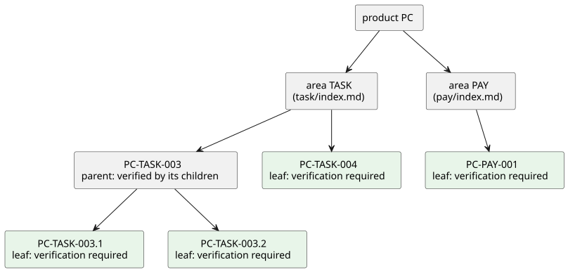
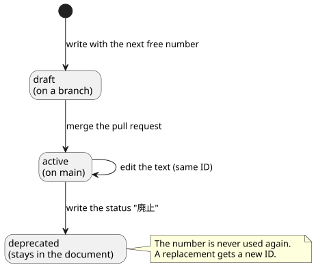

# 要件文書の書式

リポジトリの要件文書を、人にも cumin-trace にも読める形で書くためのルールを定める。この文書群も同じ書式で書いている。

## 考え方

- 1つのIDは、真偽を確かめられる1つのルールに対応する。受け入れ確認の1行と同じ粒度である。
- 要件は見出しで書く。背景や理由、例、図は、IDを持たない普通の文章として自由に書いてよい。cumin-trace はそれらを読まない。
- 要件の状態は増やさない。main にある要件はすべて有効で、下書きは merge 前のブランチにある。文書に書く状態は「廃止」だけである。
- 進捗は文書に書かない。cumin-trace が GitHub から導く ([GitHub との対応づけ](../trace/index.md))。
- いつ実現するかも要件には書かない。要件のページには、今のフェーズまでに作ると決めたことだけを書く。後回しにすることはバックログに書き、期日と、どの要求Issueがどのバージョンに入るかは、GitHub のマイルストーンで管理する。外から決まる期限 (法律の施行日など) は、概要のフェーズに、そのバージョンの期限として書く。

## 要件の書き方

1つの要件は、見出し、本文、フィールドの箇条書きの3つからなる。見出しには、バッククォートで囲んだIDと、タイトルを書く。要件の終わりには、区切り線 (`---`) を引く。

```markdown
### `PC-TASK-003` 証拠の出し直し

タスク実行者は、期日前に限り、証拠を出し直せる。

#### `PC-TASK-003.1` 出し直しの回数

出し直せるのは最大N回である。Nの既定値は1とする。

- 検証: `test`
- 検証: `demo` 実機の画面で確かめる

---

#### `PC-TASK-003.2` 期日後の出し直し

期日を過ぎたら、出し直しは受け付けない。

- 検証: `test`

---
```

IDは、プロダクト、カテゴリ、連番、子の番号を順につないだものである。


図の元ファイル: [format-id.puml](format-id.puml)

要件は、プロダクト、カテゴリ、要件、子要件という階層になる。検証を書くのは、子を持たない要件である。ディレクトリを分けるのはカテゴリまでで、子要件は親と同じページの中に、1つ深い見出しで書く。



図の元ファイル: [format-tree.puml](format-tree.puml)

要件が多いページでは、IDのない見出しで要件をまとめてよい (例: 「IDと番号」「フィールド」)。まとめるための見出しはIDに現れず、cumin-trace は読まない。まとめ方を変えても、IDは変わらない。見出しの中では、連番の順ではなく、意味の大きいものから順に並べる。

語の使い分けは [用語集](../glossary.md) にある。

要件は、ブランチで書かれ、merge されて有効になり、不要になったら廃止される。廃止しても文書からは消さない。



図の元ファイル: [format-lifecycle.puml](format-lifecycle.puml)

## 要件を変えるとき

main にある要件を変えるときは、変更の種類に応じて、次のように書く。

| 変更の種類 | 要件文書の書き方 | 要求Issue | ダッシュボードでの見え方 |
|---|---|---|---|
| ルールが増える | 新しいIDの要件を足す。並びの要件として足しても、子要件として足してもよい | 新しいIDを書いて起票する | 起票するまで、未起票に出る |
| 同じ要件の中身が変わる | IDはそのままで、本文を直す | 同じIDを書いた要求Issueを、新しく起票する | 起票するまで、未起票に出る。新しい要求Issueが開いている間は進行中、閉じると完了になる |
| 別の要件に置き換わる | 元の要件を廃止にして、新しいIDの要件を足す | 新しいIDを書いて起票する | 起票するまで、未起票に出る |

誤字の直しのように、実装に影響しない直しでは、commit のメッセージに `Requirement-Unchanged: <ID>` の行を書く。その直しは、変更として数えない。

新しく起票する要求Issueには、要件のどこが変わったかと、要件文書を直した Pull Request へのリンクを書く。

## 要件

### 文書

#### `CTR-FMT-001` 要件文書の場所と形式

要件文書は Markdown で書き、リポジトリの設定で指定したディレクトリに置く。既定のディレクトリは `docs/ja/requirements/` とする。frontmatter は書かなくてよい。

- 検証: `test` frontmatter のない文書から要件を読み取れる

---

#### `CTR-FMT-003` 要件は見出しで書く

要件は見出しとして書く。見出しには、バッククォートで囲んだID、空白1つ、要件のタイトルの順に書く。見出しのレベルは問わない。その見出しから、同じレベルか上のレベルの次の見出しまでが、その要件の範囲である。区切り線は見た目のためのもので、要件の範囲には影響しない。

- 検証: `test` 見出しのレベルが違う要件を、どちらも読み取れる。区切り線があってもなくても、同じ結果になる

---

#### `CTR-FMT-010` 要件への参照

要件の見出し以外の場所に書いた、そのプロダクトのIDを、参照と呼ぶ。本文、表、箇条書きのどこに書いてもよい。バッククォートで囲んであっても、囲んでいなくても同じである。コードブロックの中のIDと、ほかのプロダクトのIDは、参照として読まない。

cumin-trace は、参照を次の2つに使う。

- 書式検査は、参照が指す要件があることを確かめる (`CTR-CHK-001`)
- サイトは、参照を、その要件へのリンクにする (`CTR-SITE-003`)

- 検証: `test` 本文に書いたIDが、参照として読み取られる。コードブロックの中のIDは読み取られない

---

### IDと番号

#### `CTR-FMT-002` IDの形式

IDは `<プロダクト>-<カテゴリ>-<連番>` の形式とする。プロダクトとカテゴリは英大文字と数字、連番は3桁の数字である。

- 検証: `test` 形式に合わないIDをエラーにする

---

#### `CTR-FMT-011` プロダクトとカテゴリの設定

プロダクトの接頭辞と、使ってよいカテゴリの名前は、リポジトリの設定ファイル `.cumin-trace.toml` に書く。

- 検証: `test` 設定にないカテゴリのIDをエラーにする

---

#### `CTR-FMT-004` 子要件

子要件のIDは、親のIDに `.<子の番号>` を付けたものとする。子要件は、親の見出しの下に、1つ深いレベルの見出しで書く。

- 検証: `test` 親の見出しの外にある子要件をエラーにする

---

#### `CTR-FMT-012` 番号を空けない

カテゴリの中の連番は `001` から始め、1つずつ増やす。子の番号は `.1` から始め、1つずつ増やす。途中の番号を空けない。廃止した要件は文書に残るので、番号は空かない。

連番は、要件を足した順に付ける。ページの中で要件を並べる順は、連番の順でなくてよい。

要件を消すと番号が空くので、消さずに廃止にする決まり (`CTR-FMT-008`) を、書式検査で守れる。

- 検証: `test` 番号の空いた文書をエラーにする。連番の順に並んでいない文書は、エラーにしない

---

#### `CTR-FMT-009` IDを使い回さない

一度使ったIDは、別の要件に使わない。要件を別のカテゴリに移すときは、元の要件を廃止にして、移した先で新しいIDを付ける。

- 検証: `inspection` Pull Request のレビューで確かめる。cumin-trace による検出は [バックログ](../backlog.md) にある

---

### フィールド

#### `CTR-FMT-005` フィールド

要件のフィールドは `検証` と `状態` の2つとする。要件の範囲の中に、`- 検証: ...` のように箇条書きで書く。`検証` は、確かめ方が複数あるときに、複数行書いてよい。

- 検証: `test` 2つのフィールドを読み取れる。ほかの名前の箇条書きは本文として扱う

---

#### `CTR-FMT-006` 検証の方法

`検証` は、バッククォートで囲んだ方法の名前で書く。方法の名前だけで伝わらないときは、続けて確かめ方を1文で書く。要件の本文は繰り返さない。方法の名前は `test`、`demo`、`inspection`、`analysis` のいずれかである。複数の方法で確かめる要件は、方法ごとに `検証` を1行ずつ書く。

| 方法 | 意味 | 例 |
|---|---|---|
| `test` | 自動テストで確かめる | 受け入れテスト |
| `demo` | 人か Agent が実際に動かして確かめる | live scenario、画面の操作 |
| `inspection` | 文書、設定、コードを読んで確かめる | 権限の一覧の確認、レビュー |
| `analysis` | 計算や調査で確かめる | 費用の見積もり、規約の確認 |

- 検証: `test`
- 検証: `inspection` Pull Request のレビューで確かめる

---

#### `CTR-FMT-007` 検証が必要な要件

子を持たない要件には `検証` を1行以上書く。子を持つ要件は、子の検証で確かめるので、書かなくてよい。

- 検証: `test` 検証のない、子を持たない要件をエラーにする

---

#### `CTR-FMT-008` 廃止

`状態` に書けるのは `廃止` だけである。置き換え先の要件があるときは `廃止。<ID> に置き換え` と書く。廃止した要件は、文書から消さずに残す。

- 検証: `test` 廃止と置き換え先を読み取れる

---

## 未決事項

- 表の形で要件を書けるようにするか。cumin-works の `issue-states.md` のように、短いルールが多く並ぶ文書では、表のほうが収まりがよい。v0.1 は見出しだけにして、既存の文書にIDを付けるときに決める ([バックログ](../backlog.md))。
