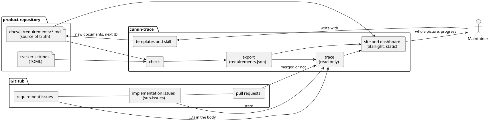

# cumin-trace 要求仕様書

## 解決したい課題

製品開発を進めるうえで最も難しいのは、次の3つを同時に保つことである。

1. 要件文書の全体を把握している
2. 要件のうち、どこまで実現できているかが分かる
3. まだ実現していない要件を、漏れなく、適切な大きさの要求Issueにできる

cumin-works には、要求Issueから先の対応づけ (要求Issue → 実装Issue → Pull Request → 受け入れ) がすでにある。つながっていないのは、要件文書から要求Issueまでの区間だけである。要件文書が大きくなると、この区間を人の目だけでは追いきれなくなる。

## 目的

Maintainer が母国語で書いた要件文書を正本にしたまま、要件の全体像と、要件 → 要求Issue → 実装Issue の進み具合を、少ない認知負荷で把握できるようにする。

## 指標

- 「要件のうち、まだ要求Issueになっていないものはどれか」に、1ページを開くだけで答えられる
- 新しい製品の要件文書を、テンプレートから書き始められる。書式を考える時間がかからない

## 位置づけ

- cumin-trace は、cumin-works 本体とは別のツールである。cumin-works との接点は GitHub だけで、要求Issueのラベルと sub-issue を読む。まずは、cumin-works を使うリポジトリを対象にする。
- 要件文書の管理の仕方は、人によって違う。まずは Maintainer 自身のやり方に合うように作る。そのうえで、ほかの人にも提供できる形にしておく。
- このリポジトリは public とする。

## 登場人物

- Maintainer: 要件文書と要求Issueを書く人。cumin-works の Maintainer と同じ
- Agent: Maintainer と一緒に要件文書を書く AI。Claude Code など
- 製品リポジトリ: 要件文書を置くリポジトリ。cumin-works など

## 全体の構成

図の元ファイル: [overview.puml](overview.puml)

- 正本は、製品リポジトリの `docs/ja/requirements/` にある Markdown である。日本語で書く。英語版を人の手で維持することはしない。
- 要件を構造化したデータ (`requirements.json`) は生成物であり、人は編集しない。
- 進み具合と、いつ実現するかは文書に書かない。cumin-trace が、GitHub のIssueとマイルストーンを読んで導く。
- 公開したくない内容は、言語ではなく機密性で分ける。価格や事業戦略は別の private リポジトリに書き、製品の要件は製品リポジトリに書く。

## cumin-trace の原則

- 決められたルールだけで動く。AI による判断を含まず、同じ入力からは常に同じ結果になる。
- 要件の意味を読み取る仕事は、Agent が受け持つ。たとえば、文書の変更を読んで要求Issueの修正を提案することは、cumin-trace は行わない。
- GitHub には書き込まない。要求Issueを作るのも、ラベルを変えるのも、Maintainer と cumin-works である。
- 要件どうしの依存は持たない。依存は、cumin-works と同じく、Issue の blocked by に書く。

## 決めたこと

2026-10-11 に決めた。

| 論点 | 決めたこと | 理由 |
|---|---|---|
| 要件文書の置き場所 | 製品リポジトリの中 | Agent が worktree から読める。要件の変更とコードの変更が、同じ履歴に並ぶ。cumin-works の保護されたパスがそのまま使える |
| 言語 | 日本語を正本にする | 書く速さと考える速さを優先する。英語の読み手には、英語で書いた要求Issueがある |
| 要件の書き方 | IDとタイトルを持つ見出しで書く。領域ごとにディレクトリを分ける | 表よりも読みやすく、理由や図を要件のそばに書ける |
| 実現する時期 | 要件には書かない。概要にはバージョンごとの目標だけを書き、期日と要求Issueの割り当ては GitHub のマイルストーンで管理する | 同じことを2か所に書くと食い違う。要件文書には作ると決めたことだけを書き、後回しは backlog に書くので、未起票の要件の一覧がそのまま起票の漏れの一覧になる |
| サイトの単位 | 製品ごとに1つ | 公開するか private にするかを、製品ごとに選べる |
| SysML v2 | 考え方だけを借りる。記法とパーサは使わない | 要件の木 (contain)、要件を実現するIssue (satisfy)、要件を確かめるテスト (verify) の3つの関係で足りる。SysML v2 の仕様書はまだ確認していない。取り入れる範囲を広げるときに確認する |
| 図 | 人が描く図は PlantUML に統一する | cumin-works と同じやり方にする。要件の木や進み具合の表示は、cumin-trace が生成する |
| ダッシュボード | サイトの中の静的なページにする | サーバを持たずに済む。画面から操作したくなったら見直す ([backlog](backlog.md)) |
| 技術 | Go で書いたコマンド、GitHub Actions、Astro + Starlight | [技術要素](technology.md) に、選んだ理由とともに書く |

## 名前

- 製品の名前は cumin-trace である。trace は、要件から実装までをたどれること (requirements traceability) を表す。
- コマンドの名前は `cumin-trace` である。
- 製品リポジトリに置く設定ファイルの名前は `.cumin-trace.toml` である。

## 進め方

- cumin-trace の要件文書は、cumin-trace の書式で書く。
- シンプルファースト、要件ファースト、ドキュメントファースト、テストファーストで進める。cumin-works と同じである。

## フェーズ

バージョンごとの目標を書く。期日の目安と、どの要求Issueがどのバージョンに入るかは、GitHub のマイルストーンで管理する。外から決まる期限があるバージョンには、その期限と理由をここに書く。今のところ、外から決まる期限はない。

| バージョン | 目標 |
|---|---|
| v0.1 | 新しい製品の要件を、この書式で書き始められる。要件 → 要求Issue → 実装Issue の状態を、1ページで見られる |
| v0.2 | cumin-works など、すでにある製品の要件を載せる。要件を変えたあとの起票の漏れに気付ける |
| v0.3 | ほかの人に提供できる |

要件のページにあるのは、今のフェーズまでに作ると決めたことである。v0.2 と v0.3 の候補は [backlog](backlog.md) にある。
