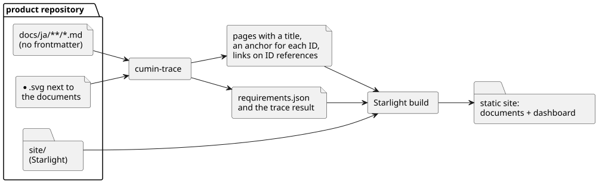

# サイト

要件文書を、読みやすいサイトとして表示するための要件を定める。サイトには Astro + Starlight を使う。

## 全体像

サイトの入力は、文書と、文書の隣にある図だけである。リポジトリの文書は書き換えない。テンプレートの Astro + Starlight が、ビルドのときに、ページのタイトル、要件のアンカー、IDの参照のリンクを補う。

図の元ファイル: [site-build.puml](site-build.puml)

Starlight は、すべてのページの frontmatter に `title` を求める (Starlight の公式文書 Frontmatter Reference で確認した)。要件文書は frontmatter なしで書くので、cumin-trace が `title` を補う。

## 要件

### テンプレートとプレビュー

#### `CTR-SITE-001` サイトのテンプレート

cumin-trace は、Astro + Starlight のサイトのテンプレートを、リポジトリに生成する。見た目は Starlight の既定のままとする。

- 検証: `demo` 新しいリポジトリで、生成したテンプレートをビルドできる

---

#### `CTR-SITE-005` 手元でのプレビュー

1つのコマンドで、手元でプレビューを始められる。GitHub を読めないときも、文書は表示される。

- 検証: `demo` token を設定せずにプレビューを始め、文書が表示される

---

### 文書の表示

#### `CTR-SITE-002` 文書を書き換えずに表示する

サイトは、リポジトリの設定で指定したディレクトリ以下の文書を、元のファイルを書き換えずに表示する。既定のディレクトリは `docs/ja/` とする。要件文書のディレクトリ (`CTR-FMT-001`) は、その中に置く。ページのタイトルには、文書の最初の見出しを使う。

- 検証: `demo` frontmatter のない文書が、タイトル付きで表示される。ビルドのあとも、元のファイルは変わらない

---

#### `CTR-SITE-003` 要件へのリンク

要件ごとに、IDをもとにしたアンカーがある。本文に書いたIDの参照は、その要件へのリンクになる。別のページの要件にもリンクする。

- 検証: `demo` 別のページにある要件への参照をクリックして、その要件に移動する

---

#### `CTR-SITE-006` 要件の区切りの表示

サイトでは、1つの要件がどこからどこまでかが、ひと目で分かる。要件を枠で囲む、背景の色を変えるなど、方法は問わない。ID は、タイトルと見分けが付く形で表示する。

- 検証: `demo` 要件が3つ続くページで、それぞれの範囲が見分けられる

---

#### `CTR-SITE-009` 文書だけから作る

サイトの文書のページは、文書と図だけを入力にして、Astro + Starlight でビルドする。ビルドとプレビューに、cumin-trace のコマンドも、構造化データの出力 (`CTR-EXP-001`) と対応づけの結果 (`CTR-TRC-008`) も使わない。ダッシュボードのページ (`CTR-DASH-001`) は、対応づけの結果を読む。

- 検証: `demo` cumin-trace のコマンドを実行せずにサイトをビルドし、タイトル、要件へのリンク、図が表示される

---

### 図

#### `CTR-SITE-004` 図の表示

文書と同じディレクトリにある SVG の図が、文書の中に表示される。

- 検証: `demo` この文書群の図が、サイトに表示される

---

#### `CTR-SITE-007` 図の拡大

文書の中の図をクリックすると、図が拡大して表示される。

- 検証: `demo` この文書群の図をクリックして、細かい文字が読める大きさで表示される

---

### 配信

#### `CTR-SITE-008` 配信先で動く

ビルドした結果は静的なファイルだけである。静的なサイトの配信先 (GitHub Pages、Cloudflare Pages など) に置けば、手元のプレビューと同じに、すべての機能が動く。

- 検証: `demo` 検証用のリポジトリのサイトを GitHub Pages に置き、要件へのリンク、図、ダッシュボードが動く

---

## 範囲外

- サイトの公開先とアクセス制限は、リポジトリの側で決める。cumin-trace は決めない。配信先に置く手順も、cumin-trace は提供しない。

## 未決事項

- 要件文書のディレクトリの外にある文書 (設計文書など) を、cumin-trace がどこまで扱うか。今は、サイトにそのまま表示するだけである。設計文書の書き方は、テンプレート (`CTR-TPL-008`) で決めた。要件のページから設計文書へのリンクは、作り方を決めたうえで、v0.2 の候補として [バックログ](../backlog.md) に入れた。
