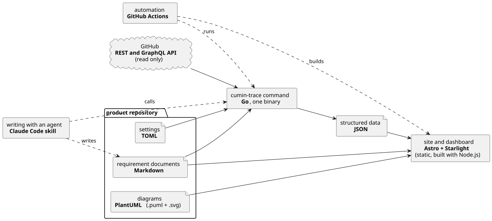

# 技術要素

cumin-trace で使う技術と、それを選んだ理由を記述する。具体的な設計は記述しない。設計は `docs/ja/designs/` の設計文書に書く。

技術の選定は Maintainer が決める制約である。要求Issueの Constraints と `CLAUDE.md` は、このページを参照する。このページの項目にはIDを付けない。起票して完了させるものではないためである。

## 構成

図の元ファイル: [technology.puml](technology.puml)

## 使う技術

| 要素 | 技術 | 選んだ理由 |
|---|---|---|
| コマンド (書式検査、出力、対応づけ、テンプレートの生成) | Go | cumin-works と同じ言語で、知識とやり方を使い回せる。単一のバイナリにでき、リポジトリや GitHub Actions に配りやすい |
| 要件文書 | Markdown | GitHub でそのまま読め、差分でレビューできる。frontmatter などの独自の記法に頼らない |
| 設定 | TOML | cumin-works と同じ形式である。コメントを書ける |
| 構造化データ | JSON | サイトのビルド (Astro) からも、Agent からも、追加の道具なしに読める |
| GitHub の読み取り | GitHub の REST API と GraphQL API を直接呼ぶ | 読むだけなので、GitHub App は要らない。`gh` コマンドに依存すると、GitHub Actions と手元で動かし方が変わる |
| サイト | Astro + Starlight | 文書のサイトに必要なもの (ナビゲーション、検索、目次) が最初からそろっている。既定の見た目のまま使う |
| ダッシュボード | Astro のページ (静的) | サイトと同じ仕組みで作れ、要件のページへ同じサイトの中でリンクできる。サーバを持たずに済む |
| 図 | PlantUML。Docker のイメージで描画する | テキストで書けて差分でレビューできる。cumin-works と同じやり方である。描画の環境を Docker で固定すると、誰が描画しても同じ SVG になる |
| 自動化 | GitHub Actions | Pull Request の書式検査と、サイトのビルドを、リポジトリの中の設定だけで動かせる |
| Agent と書くための仕組み | Claude Code の skill | Maintainer が要件を書くときに使っている道具である |
| テスト | Go の標準のテスト。GitHub は `httptest` の偽のサーバで置き換える | ネットワークなしで、どのマシンでも同じ結果になる |

## ライブラリの方針

- Go は標準ライブラリを優先する。大きな部品や、安全性に関わる部品を自分で作り直すことはしない。よく保守されているライブラリがあれば、理由を添えて提案し、Maintainer の確認を得てから足す。
- 個別のライブラリ (Markdown のパーサ、TOML のパーサなど) は、このページでは決めない。設計文書で選び、Pull Request で確認する。
- 外部の API やライブラリは、使う前に公式文書で確かめる。Astro と Starlight は、固定したバージョンの公式文書を読む。

## 決めていないこと

- リポジトリの GitHub Actions が、`cumin-trace` のコマンドをどう入手するか (`go install` か、リリースのバイナリか) と、そのバージョンをどう固定するか。
- サイトのテンプレートで、Astro、Starlight、Node.js のバージョンをどう固定し、どう更新するか。
- GitHub Actions の `GITHUB_TOKEN` で、sub-issue とマイルストーンを読めるか ([GitHub との対応づけ](trace/index.md) の未決事項)。
