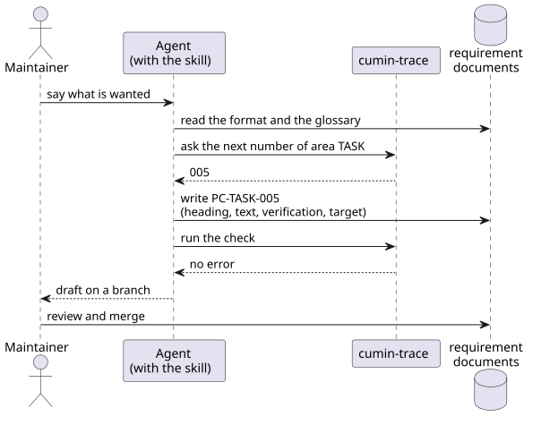

# テンプレートと skill

要件文書を書き始めるときの負担を減らし、Agent と一緒に書いても書き方がぶれないようにするための要件を定める。

## 全体像

cumin-trace は、製品リポジトリに次のファイルを生成する。

図の元ファイル: [templates-files.puml](templates-files.puml)

Maintainer は、skill を持った Agent と一緒に要件を書く。Agent は、書式と用語集を読んでから書き、書いたあとに検査を実行する。

図の元ファイル: [templates-authoring.puml](templates-authoring.puml)

## 要件

### `CTR-TPL-001` テンプレートの生成

cumin-trace は、要件文書のテンプレートを製品リポジトリに生成する。テンプレートは、入口のページ、概要、領域ごとの要件、用語集、backlog の5種類である。すでにあるファイルは上書きしない。

- 検証: test。生成した直後のテンプレートが、検査をエラーなしで通る。すでにあるファイルは変わらない

---

### `CTR-TPL-002` 概要のテンプレート

概要のテンプレートは、次の見出しを持つ: 解決したい課題、目的、指標、登場人物、範囲外、フェーズ。見出しごとに、何を書くかの説明をコメントで添える。

- 検証: inspection。テンプレートを読んで確かめる

---

### `CTR-TPL-003` 領域ごとの要件のテンプレート

領域ごとの要件のテンプレートは、次の見出しを持つ: 全体像、要件、未決事項。全体像には図を置く場所があり、要件には [書式](format.md) に沿った記入例が1つある。1つの領域を1つのページに書く。

- 検証: inspection。テンプレートを読んで確かめる

---

### `CTR-TPL-004` 次の番号

cumin-trace は、領域を指定すると、次に使える連番を答える。廃止した要件の番号は答えない。

- 検証: test。廃止した要件を含む文書で、正しい番号を答える

---

### `CTR-TPL-005` 要件を書くための skill

cumin-trace は、Agent が Maintainer と要件文書を書くための Claude Code の skill を提供する。skill は Agent に次のことを指示する。

- 書く前に、書式と用語集を読む
- 用語集にある語を、用語集の表記のとおりに使う
- 新しい要件の番号は、cumin-trace に尋ねて決める
- 書いたあとに検査を実行し、エラーを直す

- 検証: demo。skill を使って finance-v2 の要件を1つの領域ぶん書き、検査が通る

---

### `CTR-TPL-006` 図の描画

図は PlantUML で描き、`.puml` と、描画した SVG を、文書と同じディレクトリに置く。cumin-trace は、`.puml` を SVG に描画するスクリプトを製品リポジトリに生成する。スクリプトは cumin-works のものと同じ使い方にする。

- 検証: demo。生成したスクリプトで、テンプレートの図を SVG にできる

---

## 未決事項

- 図の中の文字を日本語にしてよいか。cumin-works では、図を Issue や Pull Request に貼るので英語にしている。要件文書の図は日本語の文書の中でだけ使うので、日本語のほうが読みやすい可能性がある。
