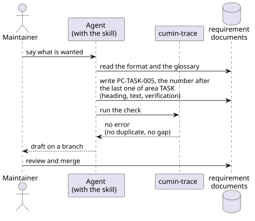

# テンプレートと skill

要件文書と設計文書を書き始めるときの負担を減らし、Agent と一緒に書いても書き方がぶれないようにするための要件を定める。

## 全体像

cumin-trace は、リポジトリに次のファイルを生成する。

図の元ファイル: [templates-files.puml](templates-files.puml)

Maintainer は、skill を持った Agent と一緒に要件を書く。Agent は、書式と用語集を読んでから書き、書いたあとに書式検査を実行する。IDの重複と番号の空きは、書式検査が見つける。

図の元ファイル: [templates-authoring.puml](templates-authoring.puml)

## 要件

### `CTR-TPL-001` テンプレートの生成

cumin-trace は、要件文書とソースコード全体構成のテンプレートをリポジトリに生成する。テンプレートは、インデックス、概要、技術要素、カテゴリごとの要件、用語集、バックログ、ソースコード全体構成の7種類である。このうち、インデックス、概要、カテゴリごとの要件、用語集、バックログは、cumin-trace が形を決める文書である。技術要素とソースコード全体構成は推奨のテンプレートで、リポジトリは自分の形で書いてもよい。設計文書のテンプレート (`CTR-TPL-008`) も推奨のテンプレートである。カテゴリごとの要件は、カテゴリの名前のディレクトリに `index.md` として生成する。ソースコード全体構成は `docs/ja/architecture/overview.md` として生成する。すでにあるファイルは上書きしない。

- 検証: `test` 生成した直後のテンプレートが、書式検査をエラーなしで通る。すでにあるファイルは変わらない

---

### `CTR-TPL-002` 概要のテンプレート

概要のテンプレートは、次の見出しを持つ: 解決したい課題、目的、指標、登場人物、範囲外、フェーズ。見出しごとに、何を書くかの説明をコメントで添える。フェーズには、バージョンごとの目標を書く。外から決まる期限 (法律の施行日など) があれば、その期限と理由も書く。自分で決める期日の目安は、GitHub のマイルストーンに書く。

- 検証: `inspection` テンプレートを読んで確かめる

---

### `CTR-TPL-003` カテゴリごとの要件のテンプレート

カテゴリごとの要件のテンプレートは、次の見出しを持つ: 全体像、要件、未決事項。全体像には図を置く場所があり、要件には [書式](../format/index.md) に沿った記入例が1つある。1つのカテゴリを1つのページに書き、そのカテゴリの図も同じディレクトリに置く。

- 検証: `inspection` テンプレートを読んで確かめる

---

### `CTR-TPL-004` 技術要素のテンプレート

技術要素のテンプレートは、次の見出しを持つ: 構成、使う技術、ライブラリの方針、決めていないこと。「使う技術」は、要素、技術、選んだ理由の3列の表である。このページの項目には、IDを付けない。

- 検証: `inspection` テンプレートを読んで確かめる

---

### `CTR-TPL-007` 用語集のテンプレート

用語集のテンプレートは、語、意味、使わない言い方、英語の4列の表である。1つの語を1行に書く。「使わない言い方」には、同じものを指す別の言い方を書き、文書ではその言い方を使わない。「英語」には、要求Issueなどを英語で書くときの訳を書く。このページの項目には、IDを付けない。

- 検証: `inspection` テンプレートを読んで確かめる

---

### `CTR-TPL-008` 設計文書のテンプレート

設計文書のテンプレートは、1つの機能を1つのディレクトリに書く形である。入口は `index.md` で、次の見出しを持つ: 要件、全体像、決めたこと、未決事項。

- 要件には、その設計が答える要件のIDとタイトルを、要件のページごとにまとめ、ページへのリンクを添えて書く
- 全体像には、ソースコード全体構成 (`CTR-TPL-009`) の中の位置と、ブロック図とシーケンス図を置く場所がある
- 決めたことには、話題ごとに、決めたこと、理由、採らなかった案、細部へのリンクを書く場所がある
- 未決事項は、書くことがなければ節ごと消す

細部は、話題ごとに同じディレクトリの別のファイルに書く。細部のテンプレートは、正確な値 (規則、表、例) を書く場所と、確かめた外部の API やライブラリ (バージョン、公式ページ、手元の実行、未確認のこと) を書く場所を持つ。

- 検証: `inspection` テンプレートを読んで確かめる

---

### `CTR-TPL-009` ソースコード全体構成のテンプレート

ソースコード全体構成のテンプレートは、コードの全体の図を置く場所と、パッケージ、役割、設計の3列の表を持つ。設計の列には、そのパッケージを持つ設計文書へのリンクを書く。設計文書の全体像に書く位置は、このページを指す。

- 検証: `inspection` テンプレートを読んで確かめる

---

### `CTR-TPL-005` 文書を書くための skill

cumin-trace は、Agent が Maintainer と要件文書と設計文書を書くための Claude Code の skill を提供する。skill は、文書の種類ごとのテンプレートを持つ。種類は、`CTR-TPL-001` の7種類と、設計文書の入口と細部である。テンプレートの文は、`CTR-TPL-001` で生成するものと同じである。skill は Agent に次のことを指示する。

- cumin-trace が形を決める文書は、新しく書くとき、その種類のテンプレートから書く
- 推奨のテンプレートの種類は、リポジトリにその種類の文書がすでにあれば、その形に合わせて書く。なければ、テンプレートから書く
- 書く前に、書式と用語集を読む
- 用語集にある語を、用語集の表記のとおりに使う
- 用語集の「使わない言い方」にある言い方を使わない
- 新しい要件の連番は、そのカテゴリでいちばん大きい連番の次にする。廃止した要件の連番も数える
- 書いたあとに書式検査を実行し、エラーを直す

- 検証: `demo` skill を使って、新しいプロダクトの要件を1つのカテゴリぶん書き、書式検査が通る
- 検証: `inspection` skill のディレクトリに、文書の種類ごとのテンプレートがある

---

### `CTR-TPL-006` 図の描画

図は PlantUML で描き、`.puml` と、描画した SVG を、文書と同じディレクトリに置く。図の中の文字は英語で書く。図は Issue や Pull Request にもそのまま貼るので、日本語版と英語版を二重に持たないためである。cumin-trace は、`.puml` を SVG に描画するスクリプトをリポジトリに生成する。スクリプトは cumin-works のものと同じ使い方にする。

- 検証: `demo` 生成したスクリプトで、テンプレートの図を SVG にできる

---

## 未決事項

- 図の中の文字を、日本語で書けるようにするか。今は英語に決めているが、ほかの人に提供するときに、すべて日本語であることを求められる可能性がある。
