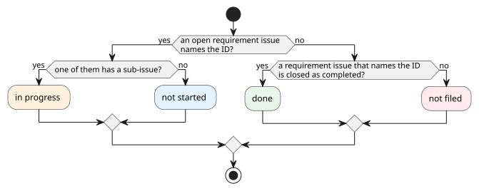

# GitHub との対応づけ

要件が、どの要求Issueと実装Issueで実現されているか、どこまで進んでいるかを、GitHub から読み取るための要件を定める。cumin-trace の中心になる機能である。

## 全体像

要件と要求Issueは、要求Issueの本文に書いたIDで結び付く。要求Issueから下は、GitHub の sub-issue と Pull Request のリンクをたどる。

図の元ファイル: [trace-links.puml](trace-links.puml)

進み具合は、要件ごとに次の順で決める。

図の元ファイル: [trace-progress.puml](trace-progress.puml)

図の中の名前と、文書での呼び方の対応は次のとおりである。

| 図 | 呼び方 | 意味 |
|---|---|---|
| not filed | 未起票 | 要求Issueがまだない |
| not started | 未着手 | 要求Issueはあるが、実装Issueに分割されていない |
| in progress | 進行中 | 実装Issueに分割され、作業が進んでいる |
| done | 完了 | 要求Issueが受け入れられて閉じた |

## 要件

### CTR-TRC-001 要求Issueの見分け方

設定で指定したラベルの付いたIssueを、要求Issueとして扱う。既定のラベルは `cumin/type/requirement` とする。開いているIssueも、閉じたIssueも読む。

- 検証: test。偽の GitHub で、ラベルのあるIssueだけが要求Issueになる
- 対象: v0.1

### CTR-TRC-002 要件と要求Issueの結び付き

要求Issueの本文にIDが書いてあれば、その要求Issueはその要件に対応する。1つの要求Issueが複数の要件に対応してよく、1つの要件に複数の要求Issueが対応してもよい。

- 検証: test。2つのIDを書いた要求Issueと、同じIDを書いた2つの要求Issueで確かめる
- 対象: v0.1

### CTR-TRC-003 実装Issueと Pull Request

要求Issueの sub-issue を、実装Issueとして読む。実装Issueごとに、開いているか閉じているかと、そのIssueを閉じた Pull Request を読む。

- 検証: test。偽の GitHub で、sub-issue と Pull Request が読み取れる
- 対象: v0.1

### CTR-TRC-004 進み具合

子を持たない要件ごとに、進み具合を次の4つのうちの1つに決める。

#### CTR-TRC-004.1 未起票

対応する要求Issueが1つもない要件は、未起票とする。対応する要求Issueがすべて not planned で閉じている要件も、未起票とする。

- 検証: test。要求Issueのない要件と、not planned で閉じた要求Issueだけを持つ要件が、未起票になる
- 対象: v0.1

#### CTR-TRC-004.2 未着手

対応する要求Issueのうち開いているものがあり、そのどれにも sub-issue がない要件は、未着手とする。

- 検証: test。sub-issue のない開いた要求Issueを持つ要件が、未着手になる
- 対象: v0.1

#### CTR-TRC-004.3 進行中

対応する要求Issueのうち開いているものがあり、その中に sub-issue を持つものがある要件は、進行中とする。

- 検証: test。sub-issue のある開いた要求Issueを持つ要件が、進行中になる
- 対象: v0.1

#### CTR-TRC-004.4 完了

対応する要求Issueに開いているものがなく、completed で閉じたものが1つ以上ある要件は、完了とする。

- 検証: test。completed で閉じた要求Issueだけを持つ要件が、完了になる。開いた要求Issueがもう1つあると、完了にならない
- 対象: v0.1

### CTR-TRC-005 子を持つ要件の進み具合

子を持つ要件の進み具合は、子の進み具合を数えて表す (例: 完了 3 / 5)。子を持つ要件そのものには、4つの進み具合を付けない。

- 検証: test。進み具合の違う子を持つ要件で、数が正しい
- 対象: v0.1

### CTR-TRC-006 食い違いの報告

次の食い違いを報告する。

- 要件文書にないIDを書いた要求Issue
- 廃止した要件に対応する、開いた要求Issue

- 検証: test。それぞれの食い違いを1つ含む状態で、報告される
- 対象: v0.1

### CTR-TRC-007 cumin-works を使わないリポジトリ

進み具合を決めるのに使うのは、Issueが開いているか、閉じた理由、sub-issue があるかの3つだけである。`cumin/status/*` のラベルがないリポジトリでも、同じ進み具合になる。

- 検証: test。`cumin/status/*` のラベルがない偽の GitHub で、同じ進み具合になる
- 対象: v0.1

### CTR-TRC-008 GitHub には書き込まない

cumin-trace は GitHub を読むだけで、Issue、ラベル、コメントのどれも変更しない。token は環境変数で受け取り、ファイルに保存せず、ログにも出さない。

- 検証: inspection。GitHub を呼び出すコードに、書き込みの呼び出しがない
- 対象: v0.1

### CTR-TRC-009 結果の出力

対応づけの結果を、GitHub を読んだ時刻とともに JSON で出力する。要件ごとに、進み具合、対応する要求Issue、実装Issueの数 (閉じた数と全体の数) を持つ。

- 検証: test。偽の GitHub で、出力を確かめる
- 対象: v0.1

## 未決事項

- 「受け入れ待ち」を、進行中と分けて見せるか。分けるには `cumin/status/awaiting-acceptance` のラベルを読む必要があり、CTR-TRC-007 の考え方と合わせて決める。v0.1 では、受け入れ待ちは進行中に含める。
