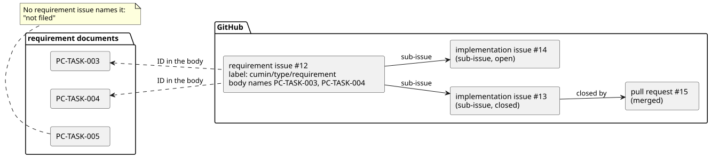
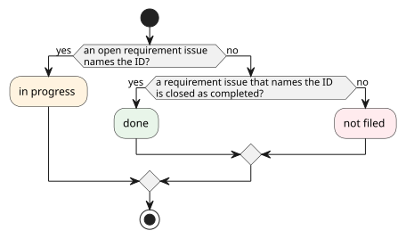

# GitHub との対応づけ

要件が、どの要求Issueと実装Issueで実現されているか、どこまで進んでいるかを、GitHub から読み取るための要件を定める。cumin-trace の中心になる機能である。

## 全体像

要件と要求Issueは、要求Issueの本文に書いたIDで結び付く。要求Issueから下は、GitHub の sub-issue と Pull Request のリンクをたどる。

図の元ファイル: [trace-links.puml](trace-links.puml)

進み具合は、要件ごとに次の順で決める。使うのは、要求Issueが開いているかと、閉じた理由だけである。

図の元ファイル: [trace-progress.puml](trace-progress.puml)

図の中の名前と、文書での呼び方の対応は次のとおりである。

| 図 | 呼び方 | 意味 |
|---|---|---|
| not filed | 未起票 | 要求Issueがまだない |
| in progress | 進行中 | 開いた要求Issueがある |
| done | 完了 | 要求Issueが受け入れられて閉じた |

要求Issueがあれば、あとは cumin-works の流れか、Maintainer の作業で進む。そこで、起票したあとの状態は細かく分けない。

GitHub は、cumin-trace が API を直接呼んで読む。GitHub App は使わない。token は、GitHub Actions では workflow に渡される `GITHUB_TOKEN` を、手元では `gh auth token` で得られるものを、環境変数で渡す。手元で動かすのは Maintainer で、Maintainer 自身のアカウントの権限で読む。cumin-works を動かす Host のアカウントで cumin-trace を動かす必要はない。

## 要件

### `CTR-TRC-001` 要求Issueの見分け方

設定で指定したラベルの付いたIssueを、要求Issueとして扱う。既定のラベルは `cumin/type/requirement` とする。開いているIssueも、閉じたIssueも読む。

- 検証: `test` 偽の GitHub で、ラベルのあるIssueだけが要求Issueになる

---

### `CTR-TRC-002` 要件と要求Issueの結び付き

要求Issueの本文にIDが書いてあれば、その要求Issueはその要件に対応する。1つの要求Issueが複数の要件に対応してよく、1つの要件に複数の要求Issueが対応してもよい。

- 検証: `test` 2つのIDを書いた要求Issueと、同じIDを書いた2つの要求Issueで確かめる

---

### `CTR-TRC-003` 実装Issueと Pull Request

要求Issueに sub-issue があれば、実装Issueとして読む。sub-issue のない要求Issueも、そのまま扱える。実装Issueごとに、開いているか閉じているかと、そのIssueを閉じた Pull Request を読む。要求Issueと実装Issueのマイルストーンも読む。

- 検証: `test` 偽の GitHub で、sub-issue と Pull Request が読み取れる

---

### `CTR-TRC-004` 進み具合

子を持たない要件ごとに、進み具合を次の3つのうちの1つに決める。

#### `CTR-TRC-004.1` 未起票

対応する要求Issueが1つもない要件は、未起票とする。対応する要求Issueがすべて not planned で閉じている要件も、未起票とする。

- 検証: `test` 要求Issueのない要件と、not planned で閉じた要求Issueだけを持つ要件が、未起票になる

---

#### `CTR-TRC-004.2` 進行中

対応する要求Issueのうち、開いているものが1つでもある要件は、進行中とする。

- 検証: `test` 開いた要求Issueを持つ要件が、進行中になる。completed で閉じた要求Issueがほかにあっても、進行中になる

---

#### `CTR-TRC-004.3` 完了

対応する要求Issueに開いているものがなく、completed で閉じたものが1つ以上ある要件は、完了とする。

- 検証: `test` completed で閉じた要求Issueだけを持つ要件が、完了になる

---

### `CTR-TRC-005` 子を持つ要件の進み具合

子を持つ要件の進み具合は、子の進み具合を数えて表す (例: 完了 3 / 5)。子を持つ要件そのものには、3つの進み具合を付けない。

- 検証: `test` 進み具合の違う子を持つ要件で、数が正しい

---

### `CTR-TRC-006` 食い違いの報告

次の食い違いを報告する。

- 要件文書にないIDを書いた要求Issue
- 廃止した要件に対応する、開いた要求Issue

- 検証: `test` それぞれの食い違いを1つ含む状態で、報告される

---

### `CTR-TRC-007` cumin-works を使わないリポジトリ

進み具合を決めるのに使うのは、要求Issueが開いているかと、閉じた理由の2つだけである。`cumin/status/*` のラベルがなく、sub-issue を使わないリポジトリでも、同じ進み具合になる。

- 検証: `test` `cumin/status/*` のラベルも sub-issue もない偽の GitHub で、同じ進み具合になる

---

### `CTR-TRC-008` GitHub には書き込まない

cumin-trace は GitHub を読むだけで、Issue、ラベル、コメントのどれも変更しない。token は環境変数で受け取り、ファイルに保存せず、ログにも出さない。必要な権限は、Issue と Pull Request の読み取りだけである。

- 検証: `inspection` GitHub を呼び出すコードに、書き込みの呼び出しがない

---

### `CTR-TRC-009` 結果の出力

対応づけの結果を、GitHub を読んだ時刻とともに JSON で出力する。要件ごとに、進み具合、対応する要求Issueとそのマイルストーン、実装Issueの数 (閉じた数と全体の数) を持つ。

- 検証: `test` 偽の GitHub で、出力を確かめる

---

## 未決事項

- sub-issue とマイルストーンを、GitHub Actions の `GITHUB_TOKEN` で読めるか。GitHub の公式文書 (Permissions required for GitHub Apps) では、どちらも Issue の読み取りの権限で読める。実装のときに、実際に呼んで確かめる。
